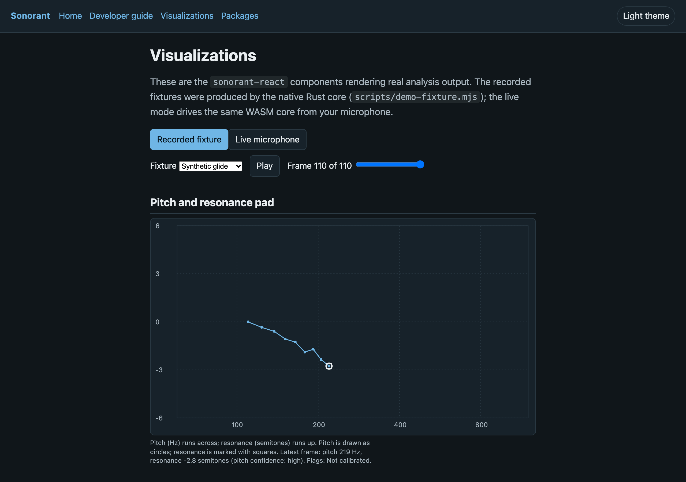
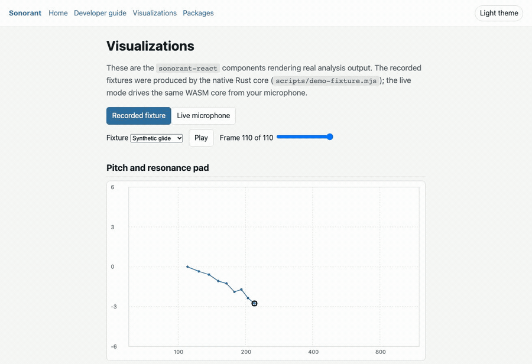
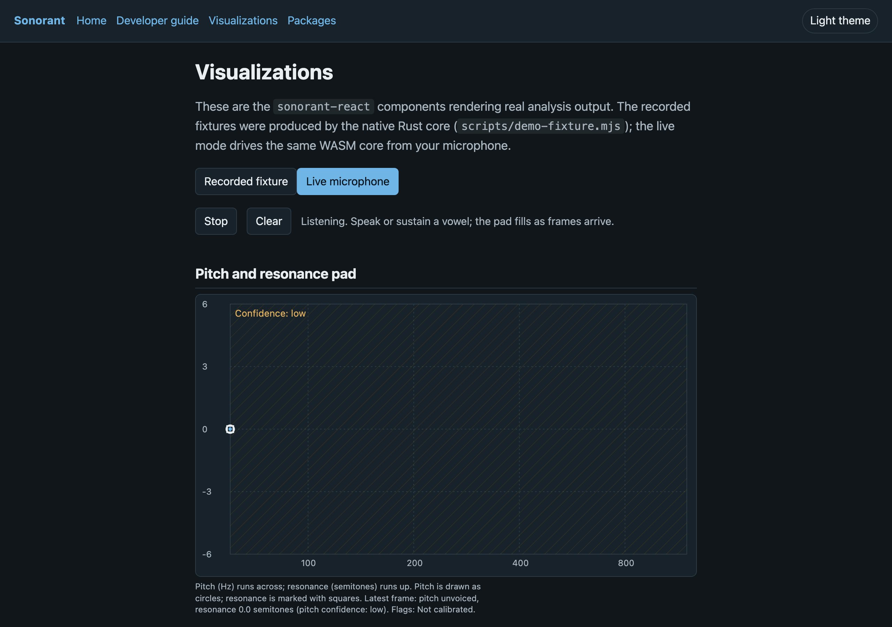
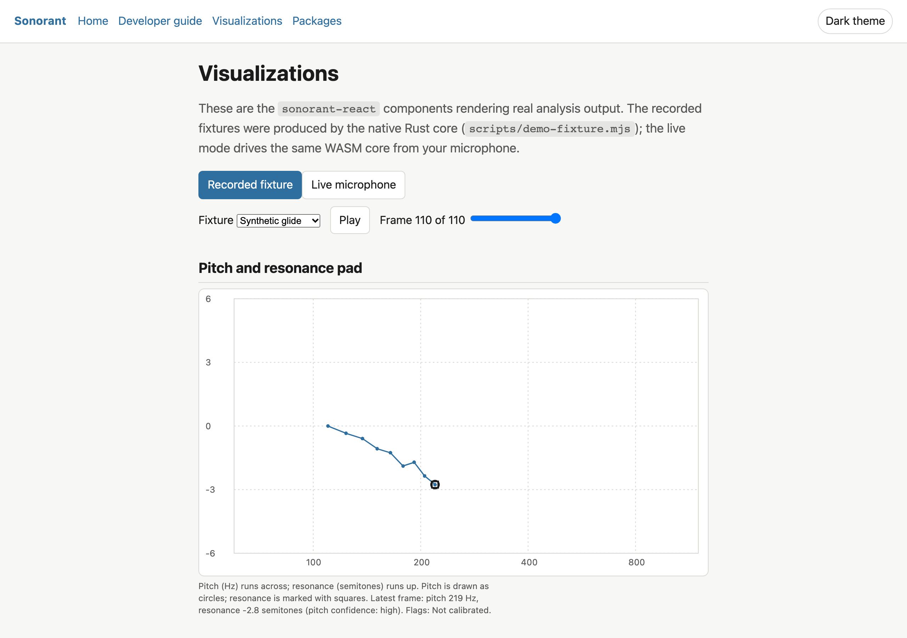

# apps/docs

The Sonorant documentation site and visualization showcase, published to GitHub
Pages by [`.github/workflows/docs.yml`](../../.github/workflows/docs.yml).

It is a Vite + React app. Two things live here:

- **Developer documentation** — how to drive the Rust core from TypeScript, the
  npm wrapper, or the CLI (`src/pages/Guide.tsx`).
- **A first-class visualization demo** — the `sonorant-react` components rendering
  real analysis output, with an opt-in live-microphone path (`src/pages/Visualizations.tsx`).

## Develop and build

```sh
npm run dev   -w @sonorant/docs     # Vite dev server
npm run build -w @sonorant/docs     # static site in apps/docs/dist
npm test      -w @sonorant/docs     # fixture shape tests
```

The dev and build scripts set `--conditions=sonorant-source`, so the site resolves
`sonorant-react` (and any package that opts in) from TypeScript source and does not
need a prior package build. The `sonorant` package is still resolved from its built
`dist`, so run `npm run build` from the repo root (Turborepo orders it) before a
standalone `npm run build -w @sonorant/docs`.

## Base path

GitHub Pages serves a project site under `/<repo>/`. The `docs.yml` workflow sets
`DOCS_BASE=/<repo>/` at build time. For a custom domain, set `DOCS_BASE=/`.

## The demo fixtures

`src/demo/*.frames.json` are **generated**, not hand-authored:

```sh
npm run wasm:build  # only if the core changed
node scripts/demo-fixture.mjs   # needs target/debug/sonorant-cli
```

`scripts/demo-fixture.mjs` runs the native `sonorant-cli` over the committed
reference vowel and over a synthetic pitch/resonance glide, and writes the per-frame
JSON the components consume. The outputs are committed, so CI needs no Rust
toolchain. The fixture-shape test in `test/` guards against a stale regeneration.

## Screenshots

The demo, rendering the committed reference fixtures:



Motion — the pad trace filling as the glide plays:



The live-microphone path (frames arriving from the WASM core), and the light theme:





Regenerate them with the site served locally:

```sh
npm run preview -w @sonorant/docs        # serving apps/docs/dist
node scripts/capture-docs.mjs            # -> apps/docs/screenshots/*.png
# motion (motion-capture skill), from the served page:
#   motion capture --url http://localhost:4190/sonorant/#/visualizations \
#     --action .motion/drive-playback.mjs --cursor --viewport 1200x820 \
#     --seconds 7 --out .motion/playback.webm
#   motion convert .motion/playback.webm \
#     --out apps/docs/screenshots/visualizations-playback.gif --max-bytes 1500000
```

## Security

The docs site is not the app. It sets a Content-Security-Policy at build time
(`script-src 'self'`, `connect-src 'self'`) but, unlike the app, it may serve its own
fonts and assets. The live demo opens the microphone only when the visitor presses
Start, analyses in the browser, and stores and sends nothing.
