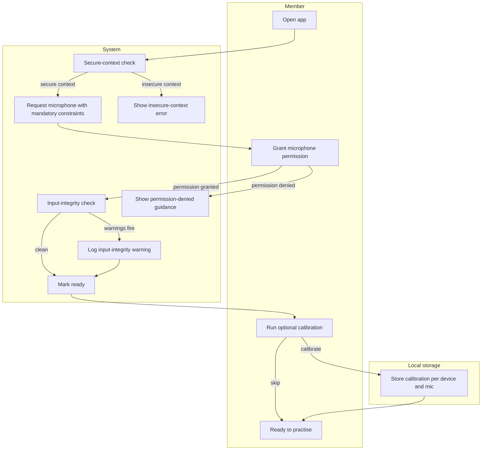
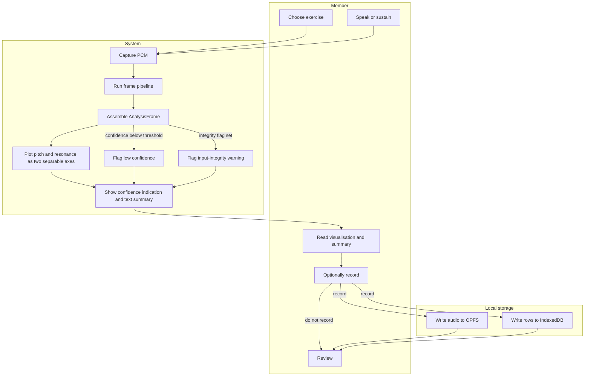
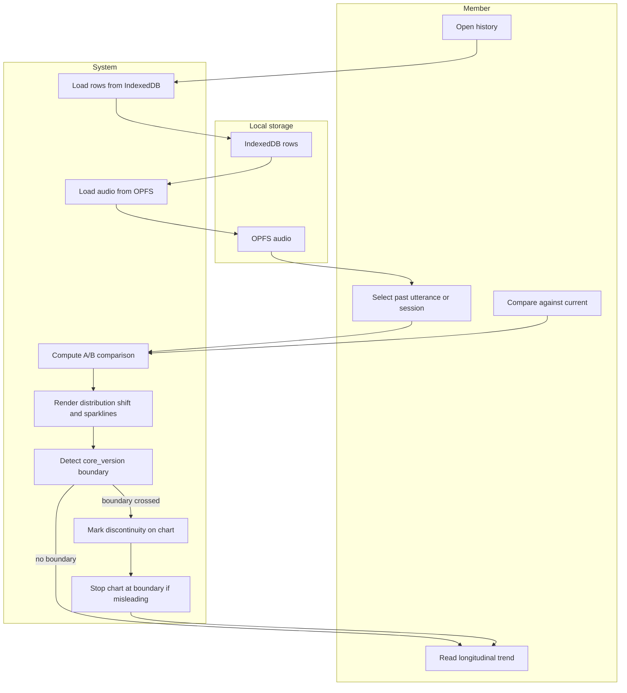
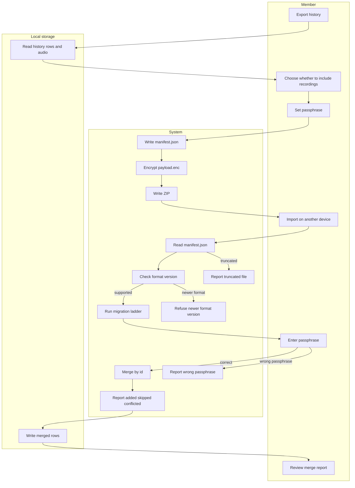
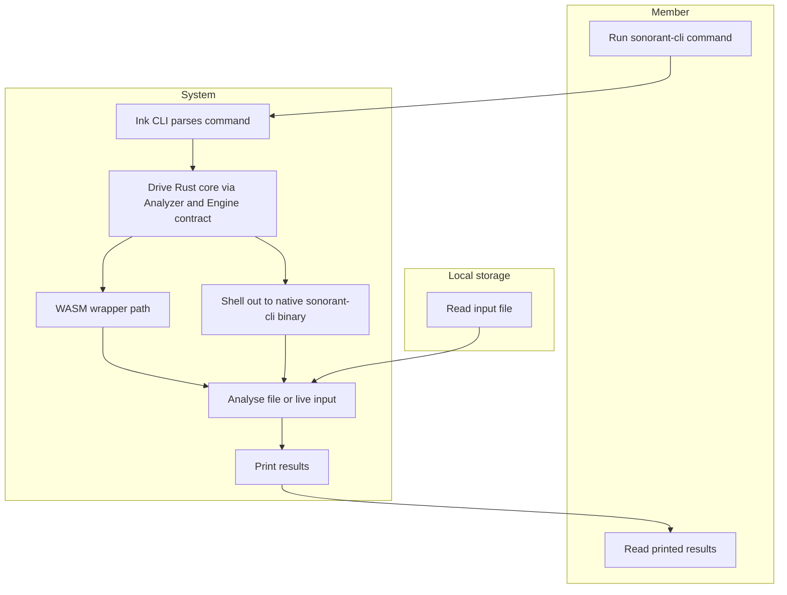

# RRF Phase 3 — Rough Visual Workflows

**Status:** draft
**Tier:** lightweight (from `rrf-00-triage`)
**Owner:** solo builder, with clinical input from a volunteer SLP
**Phase:** 3 of the Risk Reduction Delivery Framework
**Inputs:** phase 2 context ([`docs/rrf/02-five-whys-context.md`](02-five-whys-context.md))
**Output feeds:** phase 4 (risk & constraints), phase 6 (final designs), phase 7 (story split)

---

## Purpose

This is the phase-3 deliverable at the lightweight tier: end-to-end user journeys and
low-fidelity workflows, drawn as simple Mermaid flowcharts. The priority is **functional
clarity and flow logic over pixel-perfect UI** — documenting the member's step-by-step path
so the flow is agreed before visual design or backend requirements are locked.

Everything here traces to the project brief or the TDD. Where a step is not stated in either,
it is not drawn.

---

## Actors and lanes

Every diagram uses the same three lanes:

| Lane | What it is |
|---|---|
| **Member** | The person using the tool — most visibly a transgender person working on their voice, or a self-directed user without regular clinician access. |
| **System** | The Rust analysis core plus the UI/orchestration layer. The core is the single implementation of the acoustic maths; the UI is TypeScript and computes no acoustics. |
| **Local storage** | OPFS for audio blobs and IndexedDB for structured rows. Everything is local. |

**There is no backend actor.** There is no server component in v1 — not a deferred one, not
an optional one. No account, no sync, no telemetry, no audio egress. The absence of a backend
is a deliberate architectural choice, and it is why no lane for it appears in any diagram
below. (TDD §1, §12; brief §5 principle 8.)

**Reading the diagrams.** Each step names its actor by lane. Each decision point draws both
outcomes. Node labels are kept short; the prose under each diagram carries the detail and the
source.

---

## 1. First-run / setup flow

The member opens the app, the system checks the context is secure, requests the microphone
with the mandatory constraints, runs an input-integrity check, and offers optional
per-device calibration before the tool is ready.

**Detail and source.**

- **Secure-context check.** `getUserMedia` requires a secure context. `localhost` counts as
  secure, so local development needs no certificate, but any LAN or public address does.
  HTTPS is mandatory for a self-hosted deployment. (TDD §10; brief §10.)
- **Mandatory microphone constraints.** The request is not optional and not defaulted:
  `echoCancellation: false`, `noiseSuppression: false`, `autoGainControl: false`,
  `channelCount: 1`. Defaults are `true` on every major browser, and AGC in particular turns
  every dynamic-range and SPL-derived measurement into fiction. (TDD §6.1.)
- **Input-integrity check.** Some platforms apply processing below the browser — notably iOS —
  which no constraint can disable. This is logged as an input-integrity warning, not silently
  absorbed. (TDD §6.1.)
- **Optional calibration.** A calibration is per device and per mic. Any shipped default
  sensitivity must be labelled an estimate rather than a calibration, and `spl_db` stays `NaN`
  until a real calibration exists. (TDD §13.)
- **Permission denied.** The member is shown guidance rather than a dead end; the tool cannot
  capture without the microphone. (TDD §6.1.)

---

## 2. Core practice loop

The member chooses an exercise, speaks, and reads the two-axis visualisation plus a text
summary. Recording is optional. Low confidence and input-integrity warnings are surfaced, not
hidden.

**Detail and source.**

- **Exercises.** Sustained tone, glide, resonance-hold, and connected speech. (Brief §6.)
- **Frame pipeline.** Capture in the audio callback, analyse on a worker — LPC root-finding
  and cepstral analysis must not run under the real-time budget. The core consumes PCM and
  emits `AnalysisFrame`s. (TDD §4.1, §6.1.)
- **Two separable axes.** Pitch and resonance are always visually separable. They interact
  acoustically, they are separately trainable, and conflating them teaches the wrong skill —
  the failure mode this project exists to fix. (Brief §5 principle 1.)
- **Confidence indication.** Every estimate carries a confidence indication, and a value
  without a confidence is not displayable. The maths degrades fastest at high F0, which is
  exactly where the primary user group works. (Brief §5 principle 3; TDD §4.2.)
- **Text summary.** Nothing ships without a text summary, and nothing ships without a
  confidence indication. (Brief §7.)
- **Low confidence.** Mean formant confidence below 0.6 means results are not trustworthy —
  usually a mic or room problem. Voicing confidence p05 below 0.4 means an input or
  environment problem. (TDD §11.)
- **Input-integrity warnings.** More than 3 per session means the mic path is compromised.
  (TDD §11.)
- **Recording is opt-in.** Audio is written only if the member has recording enabled;
  otherwise frames are analysed and discarded in memory. (TDD §7.)

---

## 3. History & A/B comparison

The member opens history, selects a past utterance or session, compares it against the
current one, and reads a longitudinal trend. A `core_version` boundary is marked, never
silently spliced.

**Detail and source.**

- **A/B against the member's own past.** Comparison is self-referential by default — against
  the member's own baseline and their own chosen target. Normative reference bands exist but
  are off by default. (Brief §5 principle 4; §6.)
- **Longitudinal trends.** Distribution shift and sparklines. (Brief §6.)
- **`core_version` boundary.** Every stored record carries the `core_version` that produced
  it. The UI must not plot across a `core_version` boundary without marking it — a visible
  discontinuity, not a silent splice. If trends across the boundary would be misleading, the
  chart stops at it. This is the worst possible failure for a measurement tool: the chart
  shows a change in the member's voice that is actually a change in the software. (TDD §9.)
- **Storage.** Rows in IndexedDB, audio blobs in OPFS. (TDD §7.)

---

## 4. Export / import

The member exports history, chooses whether to include recordings, sets a passphrase, and
writes a ZIP. On another device they import it, and version skew is handled through the
migration ladder. Import merges by id and reports what it added, skipped, or conflicted on —
never a silent overwrite.

**Detail and source.**

- **Container.** A ZIP archive with two layouts: `manifest.json` (plaintext — format version,
  `schema_version`, `core_version`, `abi_version`, record counts, timestamp, and whether
  payloads are encrypted) and `payload.enc` (the measurements, and optionally `audio/*`
  recordings, encrypted with XChaCha20-Poly1305 under a key derived with Argon2id from a user
  passphrase). (TDD §8.)
- **Recordings are opt-in per export, separately from measurements**, because the file sizes
  and the sensitivity are entirely different. (TDD §8.)
- **Encrypted by default.** A plaintext export must be an explicit, warned choice, because a
  history file sitting in a downloads folder for years is the realistic failure mode. (TDD §8.)
- **Version skew.** Import handles version skew through the same migration ladder as the local
  store. An archive from a newer format version is refused with a clear message rather than
  partially parsed. (TDD §8.)
- **Never a silent overwrite.** Import merges by id and reports what it added, skipped, or
  conflicted on. (TDD §8.)
- **Wrong passphrase and truncated file** must fail cleanly — the archive round-trip tests
  cover both. (TDD §14.)

---

## 5. CLI flow — npm `sonorant-cli` (Ink)

The member runs a command; the Ink CLI drives the Rust core and prints results. The CLI is an
orchestration and presentation layer only, with no acoustic maths.

**Detail and source.**

- **Two TypeScript orchestration surfaces.** The web/desktop UI and the user-facing Ink CLI.
  Neither computes acoustics. (TDD §1, §3.)
- **Two routes, one contract.** The CLI drives the Rust core through the `sonorant` WASM
  wrapper, and shells out to the native `sonorant-cli` Rust binary for batch and conformance
  work where the native path is faster. Both routes go through the same `Analyzer` / `Engine`
  contract, so no maths is duplicated in TypeScript. (TDD §3.)
- **Deliberate name collision.** The Rust crate `sonorant-cli` (crates.io) and the npm package
  `sonorant-cli` (npm) share a name but live in different registries. This is intentional and
  is not an error. (TDD §3; AGENTS.md rule 5.)

---

## Edge cases

Candidate edge cases and failure branches, each with a disposition of **handled here**,
**out of scope**, or **deferred**. "Handled here" means the flow above draws the branch or the
TDD specifies the behaviour. "Out of scope" means the brief or TDD explicitly excludes it.
"Deferred" means it is a recorded open question, not a v1 commitment.

### Input and capture

| Edge case | Disposition | Where it is addressed |
|---|---|---|
| Microphone permission denied | handled here | Flow 1 branch; TDD §6.1 |
| Insecure context — no HTTPS | handled here | Flow 1 branch; TDD §10; brief §10 |
| Browser/OS audio processing that cannot be disabled, e.g. iOS | handled here | Flow 1 input-integrity warning; TDD §6.1 |
| Clipping | handled here | `CLIPPED` flag; TDD §4.1 |
| Silence | handled here | `f0_hz <= 0.0` means unvoiced; TDD §4.1 |
| Low SNR | handled here | `LOW_SNR` flag; TDD §4.1 |
| Creak | handled here | `CREAK` flag; TDD §4.1 |
| Subharmonic error | handled here | `SUBHARMONIC` flag; TDD §4.1 |
| High-F0 formant instability | handled here | `FORMANT_UNSTABLE` flag plus per-formant confidence; TDD §4.1, §4.2 |
| Uncalibrated SPL — `spl_db` is NaN | handled here | `UNCALIBRATED` flag; `spl_db` is NaN, not zero; TDD §4.2, §13 |
| Analysis latency p95 over 20 ms | handled here | Diagnostics threshold; suggest lower resolution; TDD §11 |
| Capture dropout over 0.5% of frames | handled here | Diagnostics threshold; another app contending for audio; TDD §11 |
| Mean formant confidence below 0.6 | handled here | Flow 2 low-confidence branch; TDD §11 |
| Voicing confidence p05 below 0.4 | handled here | Flow 2 low-confidence branch; TDD §11 |
| Input-integrity warnings over 3 per session | handled here | Flow 2 warning branch; TDD §11 |
| AudioWorklet cannot load an ES module | handled here | `--target no-modules` approach; TDD §6.1 |
| SharedArrayBuffer unavailable | handled here | Feature-detect SAB, use only as optimisation; TDD §6.1 |

### Versioning and integrity

| Edge case | Disposition | Where it is addressed |
|---|---|---|
| `CORE_ABI_VERSION` mismatch | handled here | Hard startup failure, not a silent misread; TDD §4.4, §9 |
| Shipped `.wasm` hash mismatch | handled here | Hard failure at startup; TDD §12 |
| Schema migration a previous release cannot read | handled here | Rollback safety rule plus archive export prompt; TDD §7.2, §10 |
| Archive version skew | handled here | Flow 4 migration ladder; TDD §8 |
| Newer archive format version | handled here | Flow 4 refusal branch; TDD §8 |
| Wrong passphrase | handled here | Flow 4 branch; TDD §14 |
| Truncated archive | handled here | Flow 4 branch; TDD §14 |
| `core_version` boundary in a trend chart | handled here | Flow 3 discontinuity branch; TDD §9 |
| Dependency phoning home | handled here | CSP `connect-src 'none'` plus bundle origin scan; TDD §12 |
| Plaintext export chosen | handled here | Explicit, warned choice; TDD §8 |
| Import overwriting existing records | handled here | Merge by id, report added/skipped/conflicted; TDD §8 |

### Device, privacy, and scope

| Edge case | Disposition | Where it is addressed |
|---|---|---|
| Device shared or lost | handled here | Nothing stored centrally; reliance on device encryption; no account to compromise; TDD §12 |
| Malicious page framing the app | handled here | `frame-ancestors 'none'`; TDD §12 |
| PHI leaking into a diagnostics blob | handled here | Redaction is part of the diagnostics function; TDD §11, §12 |
| Calibrated SPL on the web target | out of scope | Unreachable on web by design; requires the desktop path; TDD §13; brief §6 |
| Vocal dose / all-day tracking | out of scope | Deferred in the brief; requires background capture and a native shell; brief §6 |
| Reference-voice library | out of scope | Deferred in the brief; brief §6 |
| DDK, tremor, and other motor-speech measures | out of scope | Deferred in the brief; brief §6 |
| Diagnosis, screening, or triage | out of scope | Never; brief §5 principle 7, §6 |
| Social or passing scoring | out of scope | Never; brief §6 |
| Accounts, sync servers, central data | out of scope | Never; brief §5 principle 8, §6 |
| Multi-tenant isolation, server authz, audit trails | out of scope | No server and no tenancy; TDD §12 |
| Malicious fork of the project | out of scope | Out of scope technically; canonical source documented and signed releases published; TDD §12 |
| Perceptual quality testing | out of scope | Explicitly not tested; no automated assertion of sounds better; TDD §14 |
| Phoneme classifier for per-vowel analysis | deferred | Open question — build in Rust, vendor, or defer past v1; TDD §16; brief §12 |
| Whether the desktop shell ships in v1 | deferred | Open question; TDD §16; brief §12 |
| Argon2id parameters for the archive KDF | deferred | Open question against a device-class time budget; TDD §16 |
| Local store SQLite vs IndexedDB | deferred | Open question; IndexedDB handles current row shapes; TDD §16 |
| Specific microphone and calibrator pairing | deferred | Separate equipment research pass with cited sources; TDD §13, §16; brief §12 |

---

## Exit criteria

- The flow is agreed across product/design/engineering. At the lightweight tier with a solo
  builder, the builder is the reviewer; the volunteer SLP contributes clinical judgement to
  design and measurement priorities, and does not govern what the software tells a member
  about their own body. (Brief §9.)
- Edge cases are listed, each with a disposition. See the tables above.

---

## Source

- [`docs/Project brief — voice analysis & training tool.md`](../Project%20brief%20%E2%80%94%20voice%20analysis%20%26%20training%20tool.md) — problem (§2), principles (§5), scope (§6), visualisation inventory (§7), claims/ethics (§8), SLP boundary (§9), operator story (§10), open questions (§12), non-goals (§13).
- [`docs/TDD — Rust analysis core & local-first deployment.md`](../TDD%20%E2%80%94%20Rust%20analysis%20core%20%26%20local-first%20deployment.md) — no-backend decision (§1), architecture (§3), analysis core contract and flags (§4), capture constraints (§6), local storage and migrations (§7), export/import (§8), measure versioning and ABI stability (§9), deployment (§10), diagnostics thresholds (§11), security review (§12), calibration (§13), testing (§14), open questions (§16).
- [`docs/rrf/01-ideation-intake.md`](01-ideation-intake.md) — phase 1 problem statement.
- [`docs/rrf/02-five-whys-context.md`](02-five-whys-context.md) — phase 2 context this document builds on.
