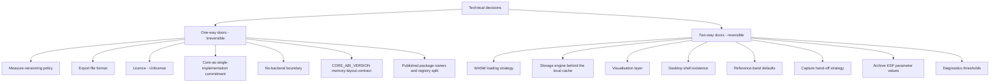

# RRF Phase 4 — Technical Constraints & Initiative Risks

**Status:** draft
**Tier:** lightweight (from `rrf-00-triage`)
**Owner:** solo builder, with clinical input from a volunteer SLP
**Phase:** 4 of the Risk Reduction Delivery Framework
**Inputs:** phase 3 workflows ([`docs/rrf/03-rough-workflows.md`](03-rough-workflows.md)); TDD §2, §5, §7.2, §9, §12, §16; brief §8, §9, §10, §12
**Output feeds:** phase 5 (architecture), phase 7 (stories), phase 10 (deploy), phase 12 (go/no-go), phase 13 (launch)

---

## Purpose

This is the phase-4 deliverable at the lightweight tier: a **Risk & Rollback Strategy** with a
decision inventory, a dependency sweep, failure modes, blast radius, a risk register, and an
explicit list of unknowns.

Everything here traces to the project brief or the TDD. Where this document classifies a decision,
the classification is a judgement and can be challenged; where it does not know something, it says
so rather than assuming. Where this document paraphrases a source, the source is authoritative.

**The one-sentence framing.** This is a local-first tool with no backend, so the blast radius of
almost every failure is a single person's own device; the rare place it widens is a self-hosting
clinician's practice (brief §9), and release-level defects that reach every self-hoster at once.

---

## 1. Decision inventory — one-way and two-way doors

From TDD §2, expanded. A **one-way door** is irreversible: once users have data, a published
artifact, or a public commitment, reversing it strands them or breaks a contract, so it gets
deliberate review before the first release. A **two-way door** is reversible: proceed, learn, and
change it later without stranding anyone.

Never classify a one-way door as two-way to save time. Where a decision's status is genuinely
contested, it is flagged for review rather than waved through.

### 1.1 One-way doors

| # | Decision | What makes it one-way | Source |
|---|---|---|---|
| OW-1 | **Measure-versioning policy** — `CORE_VERSION` semver where MAJOR means a published measure can shift beyond its documented tolerance; every stored record carries the `core_version` that produced it. | Once users have months of history, changing an algorithm silently invalidates their trends; the policy has to exist before the first release, not after. The chart would show a change in the user's voice that is actually a change in the software. | TDD §2, §9 |
| OW-2 | **The export file format** — ZIP container, plaintext `manifest.json`, encrypted `payload.enc`; XChaCha20-Poly1305 AEAD under an Argon2id-derived key. | Users will have years of archives in it. Changing the container, the AEAD, or the KDF algorithm breaks every existing archive unless a migration ladder is built first. | TDD §2, §8 |
| OW-3 | **The licence** — Unlicense (decided). | A licence cannot be retracted from code already granted. The decision is recorded, with its accepted cost (a commercial actor may re-absorb) and its rationale (public domain is far easier for clinic and health-system legal review than copyleft). | TDD §2; brief §0, §8 |
| OW-4 | **The core-as-single-implementation commitment** — acoustic maths lives only in the Rust core; no acoustic maths in TypeScript, ever, not even a fallback; the acoustic layer is written in-house rather than taken from a crate. | A second implementation is how the two diverge silently. Once users accumulate data produced by the in-house tracker, swapping to a vendored tracker shifts every stored measure — which the one-way measure-versioning policy (OW-1) can only label, not undo. | TDD §1, §2; brief §0 |
| OW-5 | **The no-backend boundary** — no server, no account, no telemetry, no audio egress, no network client in the dependency graph; CSP `connect-src 'none'`. | The TDD states it plainly: if a backend is ever added, the entire security review (§12) is void and the whole design must be revisited. It is the reason the tool is deployable by a clinic and sustainable by one person. | TDD §1, §12; brief §5 principle 8, §10 |
| OW-6 | **The `CORE_ABI_VERSION` memory-layout contract** — a flat, fixed-size `AnalysisFrame` read as a `Float32Array` over `memory.buffer`; layout versioned, mismatch is a hard startup failure. | The brief lists **ABI stability** among the irreversible items. It is a published interface contract that external consumers (the npm `sonorant` wrapper, and the JS reader) depend on; a silent layout change would misread every field. | TDD §4.3, §4.4, §9.5; brief §0 |
| OW-7 | **Published package names and registry split** — npm `sonorant` and `sonorant-cli`; crates.io `sonorant-cli`; the deliberate cross-registry name collision. | A published package name is a durable public contract: consumers depend on it, and the name may not be reclaimable after unpublish. Before the first publish this is freely changeable; the moment it is published it becomes one-way. Flagged for review at the first-publish step. | TDD §3, §5; AGENTS.md rule 5 |

### 1.2 Two-way doors

| # | Decision | What makes it two-way | Source |
|---|---|---|---|
| TW-1 | **WASM loading strategy** — `wasm-bindgen --target no-modules` with instantiate-in-worklet, or a JS `AudioWorkletProcessor` calling into WASM. | Both approaches sit behind the same capture contract; swapping them changes no stored data and no published interface. | TDD §2, §6.1 |
| TW-2 | **Storage engine behind the local cache** — IndexedDB versus SQLite via a WASM build. | The schema is the contract, not the engine. IndexedDB is deferred-in-favour for now; SQLite remains an open question and can be adopted behind the storage layer without changing the archive format. | TDD §2, §7, §16.6 |
| TW-3 | **Visualisation layer** — the UI framework and charting approach. | Presentation only. `scale_semitones` and every acoustic quantity are computed in the core, so the visualisation layer can be replaced without touching a measure. Perceptual mapping (Bark, semitone conversion, reference comparison) lives in the UI by design. | TDD §2, §4.2 |
| TW-4 | **The desktop shell's existence** — whether Tauri 2 ships in v1. | Explicitly reversible: the shell reuses the entire web UI, and shipping it later is an addition rather than a fork. If it does ship, `sonorant-capture` and the calibration flow move into the critical path. | TDD §2, §1 driver 5, §16.4; brief §12.2 |
| TW-5 | **Every reference-band default** — normative bands exist but are off by default. | A default value with no stored consequence; changing it changes no history and no format. | TDD §2; brief §5 principle 4, §8 |
| TW-6 | **Capture hand-off strategy** — `postMessage` with transferable buffers by default, `SharedArrayBuffer` feature-detected as an optimisation only. | A performance mechanism behind the capture contract; reversible without changing stored data. The COOP/COEP deployment cost is the reason it is not the default. | TDD §6.1 |
| TW-7 | **Archive KDF parameter values** — Argon2id `m`, `t`, `p`. | The parameters are recorded per archive in `manifest.json`, so a future release can raise them for new archives while still opening old ones, and an existing archive can be re-encrypted by export → import. Distinct from the algorithm choice, which is part of OW-2. **The values themselves are an open question (see §7).** | TDD §8, §16.5 |
| TW-8 | **Diagnostics thresholds** — analysis latency p95 > 20 ms, capture dropout > 0.5%, mean formant confidence < 0.6, voicing confidence p05 < 0.4, input-integrity warnings > 3 per session. | Tunable guidance values surfaced in-app, not stored commitments; changing them reclassifies no history. | TDD §11 |

---

## 2. Dependency sweep

**There is no backend, no server, no third-party service, and no network client.** This is not a
simplification — it is the architectural boundary (OW-5). No dependency below is a network client,
and none is a runtime service that can be "down" in the operational sense.

| Dependency | Type | Notes | Source |
|---|---|---|---|
| **Rust toolchain + Cargo workspace** | Build toolchain | Maintained by one person. A consequence accepted in the TDD. | TDD §1, §3 |
| **Crates in the TDD §5 register** | Build/runtime (compiled in) | `rustfft`, `realfft`, `cpal`, `wasm-bindgen`/`js-sys`/`web-sys`, `hound`, `symphonia`, `serde`/`serde_json`, `chacha20poly1305` + `argon2`, `zip`, `thiserror`. Licence-verification status per §5: `rustfft`, `realfft`, `cpal`, `wasm-bindgen` set, `serde`, `chacha20poly1305`+`argon2`, `thiserror` marked "verify"; `hound`, `symphonia`, `zip` also "verify". **`symphonia` is MPL-2.0 — file-level copyleft, acceptable only if unmodified, with an explicit exception comment.** | TDD §5 |
| **`pitch-detection`, `pyin-rs`** | Evaluate only — not a dependency | Licence **unverified**. `pitch-detection` is to be read and the tracker written in-house against de Cheveigné & Kawahara (2002) and McLeod & Wyvill (2005). | TDD §5, §16.1 |
| **`loqa-voice-dsp`, `syne_audio_dsp`** | Evaluate only — not a dependency | Prior art in this exact product space. Licence **unverified**. Reference reading only; depending on a crate built for a competing product is both a strategic and a supply-chain risk. | TDD §5, §16.1 |
| **`wasm-pack` / `wasm-bindgen`** | Build toolchain | Produces the web `.wasm` artifact. The `--target web` ES-module limitation inside `AudioWorklet` is a known toolchain limitation, not a configuration mistake. | TDD §6.1, §15 |
| **npm + Turborepo** | Build toolchain | TypeScript workspace and task graph. UI/orchestration only. | TDD §3 |
| **Browser `getUserMedia` / `AudioWorklet`** | Platform API (external, not controlled) | Browser owns the microphone; no Rust API reaches it. Constraints are mandatory; some processing cannot be disabled. | TDD §6.1 |
| **OS audio stack** | Platform API (external, not controlled) | `cpal` on desktop, platform-native backends on mobile. Some platforms (notably iOS) apply processing below the browser that no constraint can disable. | TDD §6.1, §6.2 |
| **User's device storage (OPFS / IndexedDB)** | Platform API (external, not controlled) | OPFS for audio blobs, IndexedDB for structured rows. Nothing leaves the device. | TDD §7 |
| **Static host + TLS certificate** | Deployment (self-hoster-owned) | A static bundle from any static host, CDN, object store, or local Caddy/nginx. HTTPS is mandatory because `getUserMedia` requires a secure context; a self-signed cert or local CA is documented workflow. Applicable only to the self-hosting clinician. | TDD §10; brief §10 |
| **Praat (offline validation oracle)** | Dev-only — ships nothing | GPL; permitted only as an offline oracle that generates conformance fixtures. Never a dependency. | TDD §5, §14 |
| **Volunteer SLP** | Human / stakeholder | Clinical judgement to design and measurement priorities — **not** clinical validation of outputs. Does not govern what the software tells a user about their own body. | Brief §4, §9 |

### 2.1 Explicit unknowns in this sweep

Per TDD §16.1, these licences are **unverified** and must be verified before any becomes a
dependency: `pitch-detection`, `pyin-rs`, `hound`, `symphonia`, `zip`, and both prior-art voice
crates (`loqa-voice-dsp`, `syne_audio_dsp`). The TDD §5 register already flags `hound`, `symphonia`,
and `zip` as "verify". These are recorded here as unknowns, not assumptions.

---

## 3. Failure modes

For each dependency and new component: what happens when it is wrong, slow, or down. Not every
item has a "down" state — this is a local tool with no service tier — and where "down" does not
apply it is said so.

### 3.1 New components

| Failure | When it is wrong / slow | Detection | Source |
|---|---|---|---|
| **High-F0 formant estimation degrades** | The maths degrades fastest at high F0 — exactly where the primary user group works. This is the project's differentiator, so degrading here is a core-value failure, not a cosmetic one. | Per-formant `confidence`; `FORMANT_UNSTABLE` flag; mean formant confidence < 0.6 warning; published conformance fixtures with per-measure tolerance bands. | Brief §5 principle 3; TDD §1 driver 2, §4.1, §4.2, §11, §14 |
| **`core_version` boundary silently spliced** | A trend chart shows a change in the user's voice that is actually a change in the software — "the worst possible failure for a measurement tool". | Every stored record carries `core_version`; the UI detects the boundary and marks a visible discontinuity or stops the chart. | TDD §9 |
| **Schema migration a previous release cannot read** | A user downgrades (or a self-hoster rolls back) and is stuck with data they cannot open. | Migration fixture store at the previous version, run in CI; the rollback safety rule (§7.2). | TDD §7.2, §14, §10 |
| **Analysis latency p95 > 20 ms** | The device is struggling; frames may glitch or lag. | Local diagnostics panel latency threshold. | TDD §11 |
| **Capture dropout > 0.5% of frames** | Another app is contending for audio; the session is unreliable. | Local diagnostics panel dropout threshold. | TDD §11 |

### 3.2 Platform dependencies

| Failure | When it is wrong / slow / unavailable | Detection | Source |
|---|---|---|---|
| **Browser/OS audio processing that cannot be disabled** | Notably iOS applies processing below the browser that no constraint can disable. AGC in particular turns every dynamic-range and SPL-derived measurement into fiction. | Logged as an input-integrity warning, not silently absorbed; measured audio-path properties (sample rate, channel count, what processing was applied) shown in diagnostics. | TDD §6.1, §11 |
| **Microphone permission denied** | The tool cannot capture; there is no fallback, because there is no server and no other input path. | `getUserMedia` rejection. | TDD §6.1 |
| **Insecure context (no HTTPS)** | `getUserMedia` is unavailable; the app cannot run. Most likely where a self-hoster gets stuck. | Secure-context check before requesting the microphone. | TDD §10; brief §10 |
| **`getUserMedia` / `AudioWorklet` unavailable or changed** | A browser API change or omission breaks capture; the worklet cannot load an ES module as-is. | Build-time and conformance tests; the `--target no-modules` workaround and the JS-processor alternative. | TDD §6.1 |
| **OS audio stack unavailable / contended** | No capture, or dropouts. | Diagnostics dropout threshold; device enumeration at start. | TDD §6.2, §11 |
| **User's device storage full or evicted** | OPFS/IndexedDB writes fail; recordings or rows may be lost. Local-only storage is not exempt from device failure. | Write errors; the archive is the user's backup. | TDD §7, §8 |

### 3.3 Versioning, integrity, and supply chain

| Failure | What happens | Detection | Source |
|---|---|---|---|
| **`CORE_ABI_VERSION` mismatch** | Hard startup failure, not a silent misread. | Startup comparison of the JS reader against the core layout. | TDD §4.4, §9.5 |
| **Shipped `.wasm` hash mismatch** | Hard failure at startup. | Recorded hash compared at startup; signed releases and provenance attestations. | TDD §12 |
| **Schema migration a previous release cannot read** | User cannot open their data after a rollback. | CI migration against a previous-version fixture; rollback safety rule. | TDD §7.2 |
| **Archive version skew** | Handled through the same migration ladder as the local store. | `manifest.json` `format_version` check. | TDD §8 |
| **Archive from a newer format version** | Refused with a clear message rather than partially parsed. | Format-version check on import. | TDD §8 |
| **Wrong passphrase** | Fails cleanly; no partial parse. | XChaCha20-Poly1305 authentication failure. | TDD §8, §14 |
| **Truncated archive** | Fails cleanly. | ZIP/AEAD integrity failure; archive round-trip tests cover truncation. | TDD §8, §14 |
| **Dependency licence fails the `cargo-deny` gate** | The build fails — not the review. | `cargo-deny` with `licenses` and `advisories`, `cargo-audit`, `deny.toml` allowlist (MIT / Apache-2.0 / BSD-3-Clause / ISC / MPL-2.0 / Unlicense; MPL needs an exception comment). | TDD §5, §12 |
| **A dependency attempts egress** | The request fails under CSP `connect-src 'none'`; the CI bundle origin scan fails the build on any external origin. This is the realistic "dependency phones home" failure mode. | CSP at runtime; bundle origin scan on every build. | TDD §12, §14 |
| **Build toolchain / registry unavailable** | Cannot build or release. No vendoring or offline-build strategy is specified in the TDD. | Build/CI failure. **Mitigation unknown — see §7.** | Not specified in TDD |

---

## 4. Blast radius

**For this project the blast radius is a single user's own device.** There is no central store, so
a failure corrupts or inconveniences the data on the device where it happens and nobody else's.
Who notices first depends on the failure:

| Failure class | Who notices first |
|---|---|
| Measurement quality, confidence, capture integrity | The **member** — on their own device, immediately. |
| Data-stranding failures (migration, archive skew, rollback) | The **member** (or the self-hosting clinician, on their own environment). |
| Deployment failures (insecure context, TLS, static bundle) | The **self-hosting clinician** — this is the one place the radius widens. |
| Build/supply-chain failures (licence gate, egress scan, ABI/hash) | **Internal only** — caught before any artifact ships. |
| A release defect reaching every self-hoster at once | **All self-hosters together** — the widest radius this tool has; mitigated by keeping the previous release artifact (§6). |

**The one place it widens.** Per brief §9: if the volunteer SLP starts using this with their own
clients, three things shift — their practice's professional-records obligations attach to whatever
they store, any output that sounds like an assessment becomes their professional-liability question,
and their name on the project acquires a different meaning. This is currently undecided, and the
response is architectural rather than legal: the design already avoids all three by having no
backend, no diagnosis, and no clinical verdicts. The risk to record is the **drift** toward clinical
output "because an SLP is involved", which is precisely what would make it unsafe for them to adopt
later.

**What this is not.** There is no multi-tenant isolation, no server-side authz, and no audit trail,
because there is no server and no tenancy (TDD §12). Any blast-radius question that assumes a
backend is out of scope for v1.

---

## 5. Risk register

**Likelihood values are the builder's initial qualitative estimate at the lightweight tier, not
measured data.** They are marked as estimates and should be revisited as evidence accrues. Door
type names the decision the risk sits under, not the risk itself.

| Risk | Likelihood | Blast radius | Detection | Mitigation | Rollback path | Door type |
|---|---|---|---|---|---|---|
| High-F0 formant estimation degrades — the exact region the primary user group works in | Medium-High (estimate) | Member (trust in the core value) | Per-formant confidence; `FORMANT_UNSTABLE`; mean formant confidence < 0.6; conformance fixtures | In-house core tuned for high F0; documented per-measure tolerance bands; confidence is not displayable-free; self-referential baseline | Revert release (two-way for code) — governed by measure-versioning policy | Two-way, governed by OW-1 |
| Changing an algorithm silently invalidates months of trends | Medium (estimate) | Member (data meaning) | Stored `core_version`; chart boundary detection | Measure-versioning policy exists before first release; mark discontinuity; stop chart if misleading | One-way policy; MAJOR bump + relabel historical points | OW-1 |
| Export format change strands years of archives | Low-Medium (estimate) | Member (data portability) | Archive round-trip tests with skew both directions | Format version in `manifest.json`; migration ladder; refuse newer format cleanly | Re-export at matching version; migration ladder | OW-2 |
| Commercial re-absorption under Unlicense | Low-Medium (estimate) | Project / community (not member device) | n/a — monitoring forks | Publish methodology, measurement docs, conformance fixtures; trust and community; signed releases | None — decision accepted | OW-3 |
| Acoustic maths duplicated in TypeScript, diverging silently | Low (estimate) | Member (measurement honesty) | ABI test; capture-shim conformance fixtures across both surfaces | No acoustic maths in TypeScript, ever; single shared `Analyzer`/`Engine` contract | Revert the divergent surface | OW-4 |
| No-backend boundary breached by feature drift | Low (estimate) | Whole design and privacy model | Architecture review; no network client in dependency graph; §12 void condition | Written boundary in brief and TDD; CSP `connect-src 'none'`; no third-party SDKs | None without a full redesign — hence one-way | OW-5 |
| `CORE_ABI_VERSION` mismatch misreads frames | Low (estimate) | Member / self-hoster | Hard startup failure on version compare; ABI test in CI | Version constant; all artifacts built from one commit and one `CORE_VERSION` | Restore previous static bundle | OW-6 |
| Published package name cannot be reclaimed / renamed | Low (estimate) | Public consumers | Release-process review before first publish | Confirm names and the registry split; document the deliberate collision | None after publish | OW-7 |
| Browser/OS audio processing that cannot be disabled (notably iOS) | Medium (estimate) | Member (measurement validity) | Input-integrity warning; diagnostics audio-path properties | Mandatory `getUserMedia` constraints; log rather than absorb; label affected measures | Revert release; no data change | Two-way |
| Microphone permission denied | Medium (estimate) | Member (cannot run) | `getUserMedia` rejection | Guidance flow, not a dead end | n/a | Two-way |
| Insecure context — self-hoster has no TLS | Medium for self-hosters (estimate) | Self-hosting clinician + member | Secure-context check before mic request | HTTPS mandatory; `localhost` counts as secure; document self-signed / local-CA workflow | Fix deployment config | Two-way |
| Schema migration a previous release cannot read | Medium (estimate) | Member (data) | CI migration against previous-version fixture | Forward-only expand/contract; rollback safety rule; archive export prompt; keep previous artifact | Restore previous bundle + export prompt | One-way (schema with history) |
| Archive version skew | Medium (estimate) | Member (portability) | `format_version` check; round-trip tests | Same migration ladder as local store | Re-export at matching version | Two-way |
| Archive from a newer format version | Medium (estimate) | Member (portability) | Format-version check | Refuse with a clear message; never partial-parse | Upgrade the app, or re-export on the newer device | Two-way |
| Wrong passphrase | Medium (estimate) | Member (access) | AEAD authentication failure | Clear message; no partial parse | Retry with correct passphrase | Two-way |
| Truncated archive | Low-Medium (estimate) | Member (access) | ZIP/AEAD integrity failure; tests cover truncation | Fail cleanly | Re-export from source device | Two-way |
| Dependency licence fails the `cargo-deny` gate | High (estimate — many "verify" entries) | Internal (build) | `cargo-deny` in CI | Allowlist MIT / Apache-2.0 / BSD-3-Clause / ISC / MPL-2.0 / Unlicense; MPL exception comment; evaluate-not-depend for unverified crates | Remove or replace the dependency before merge | Two-way (dependency choice); licence policy is one-way |
| Unverified licence discovered late in an evaluate-only crate | Medium-High (estimate) | Internal (build / strategy) | TDD §16.1 tracking; pre-dependency verification | Verify before use; read `pitch-detection`/`pyin-rs` and write the tracker in-house | Drop the crate; use in-house implementation | Two-way |
| Compromised dependency attempts audio egress | Low-Medium (estimate) | Member (privacy) | CSP `connect-src 'none'`; CI bundle origin scan fails on any external origin | No third-party scripts/SDKs; `cargo-deny` + `cargo-audit`; SBOM and provenance attestations | Revert release; pin/advisory fix | Two-way |
| Analysis latency p95 > 20 ms on a weak device | Medium (estimate) | Member (usability) | Diagnostics latency threshold | Analyse on a worker, never under the real-time audio budget; suggest lower resolution | Revert release | Two-way |
| Capture dropout > 0.5% of frames | Medium (estimate) | Member (reliability) | Diagnostics dropout threshold | Copy-to-ring-buffer hand-off; surface the warning | Revert release | Two-way |
| Self-hosting clinician adopts with clients; professional-records obligations attach | Unknown / undecided | Widens to the practice | Documented boundary and operator docs | Architecture already avoids it (no backend, no diagnosis, no verdicts); honest operator caveats | Architectural — no code change needed | OW-5 (no-backend boundary) |
| SLP collaboration drifts toward clinical output | Low (estimate) | Member + SLP liability | Scope/claims review against brief §5 and §9 | Measurement-only boundary; deliberate language — "clinical input", never "clinically validated" | Revert the feature | One-way (nothing-diagnostic boundary) |
| Build toolchain / registry unavailable (no vendoring strategy) | Low (estimate) | Internal (build only) | Build/CI failure | **Unknown — no strategy specified (see §7)** | Retry when available | Two-way |

---

## 6. Risk & Rollback Strategy

A rollback path exists for every two-way decision; every one-way decision is flagged for review.
There is no stateful service to unwind, so rollback is unusually simple — and unusually *total*,
because the previous release artifact is the rollback.

### 6.1 Two-way decisions — revert path and speed

- **Release-level (all of the two-way doors).** Rollback is restoring the previous static bundle.
  Because there is no stateful service, this is the entire mechanical rollback. The TDD makes it a
  documented, one-command operation for self-hosters. Speed: as fast as serving the old bundle.
- **Storage engine (TW-2), visualisation layer (TW-3), WASM loading (TW-1), capture hand-off
  (TW-6).** Revert the code; no stored data carries the choice.
- **Desktop shell (TW-4).** Not shipping it is the default; deferring or removing it changes no
  stored data.
- **Reference-band defaults (TW-5) and diagnostics thresholds (TW-8).** Revert the value; no
  history is affected.
- **Archive KDF parameters (TW-7).** Raise for new archives; old archives remain readable because
  parameters are recorded per archive; re-encrypt an existing archive by export → import.

### 6.2 One-way decisions — review requirement

Each one-way door requires deliberate review **before the first release** (and, for the published
package names, **before the first publish**):

- **OW-1 measure-versioning policy** — review that the policy exists and the per-measure tolerance
  bands are documented *before* any user can accumulate history.
- **OW-2 export format** — review the container, AEAD, and KDF algorithm before any archive exists in
  the wild; after that, changes go through the migration ladder.
- **OW-3 licence** — already decided (Unlicense); no further review unless the decision is reopened.
- **OW-4 core-as-single-implementation** — review any proposal to add a second maths implementation,
  in any language, on any target.
- **OW-5 no-backend boundary** — review any proposal that introduces a server, account, sync, or
  network client; adding one voids TDD §12 and requires the whole design to be revisited.
- **OW-6 `CORE_ABI_VERSION` contract** — review any change to the memory layout; it is versioned
  and a mismatch is a hard failure, but the stability commitment itself is one-way.
- **OW-7 package names / registry split** — review and confirm names before the first publish;
  irreversible thereafter.

### 6.3 The rollback safety rule (TDD §7.2)

> **A schema change must be readable by the immediately previous release, or it must be accompanied
> by an archive export prompt. Users must never be stuck with data they cannot open.**

This is the load-bearing rule that makes the rest of the strategy sufficient. Forward-only
expand/contract, on both the local store and the archive container. Every migration ships with a
fixture store at the previous version, and CI runs the migration against it. If a change cannot be
read by the immediately previous release, the app prompts for an export first.

### 6.4 Keep the previous release artifact

Because there is no server, rollback means serving the previous static bundle. The previous release
artifact is **retained** — it is the rollback strategy — and the procedure is one documented
command. This is sufficient precisely because there is no stateful service and because §6.3
guarantees schema compatibility with the previous release. The shipped `.wasm`, the CLI binary, and
the desktop shell are all built from the same commit and the same `CORE_VERSION`; a release where
they differ is a release defect (TDD §15).

### 6.5 Rollback triggers (feeds phase 12)

- A measurement's conformance fixtures move beyond its documented tolerance without a MAJOR bump.
- A schema change not readable by the immediately previous release ships without an export prompt.
- The CI egress scan fails (a dependency phones home).
- A shipped artifact fails the `.wasm` hash check or the ABI test.
- Any drift toward a clinical verdict, a composite score, or a backend.

---

## 7. Unanswered questions (explicit unknowns)

Listed rather than assumed. Reproduced from TDD §16, with the brief §12 overlaps noted. These do
not block starting on `sonorant-cli`, which the TDD names as the correct first artifact.

1. **Unverified licences** for `pitch-detection`, `pyin-rs`, `hound`, `symphonia`, `zip`, and both
   Rust voice crates (`loqa-voice-dsp`, `syne_audio_dsp`). All must be verified before any becomes a
   dependency. (TDD §16.1; §5 register flags `hound`, `symphonia`, `zip` as "verify".)
2. **Specific microphone and calibrator pairing** — a separate equipment research pass with cited
   sources. The category is verified (Class 1, IEC 60942, 1 kHz at 94 dB, ½″ couplers, ¼″ adapters),
   but a specific pairing is not, and nothing should be bought on the basis of the documents.
   (TDD §16.2, §13; brief §12.1.)
3. **Phoneme classifier** for per-vowel analysis — build in Rust, vendor, or defer past v1.
   (TDD §16.3; brief §12.3.)
4. **Whether the desktop shell ships in v1** — if yes, `sonorant-capture` and the calibration flow
   move into the critical path rather than staying deferred. (TDD §16.4; brief §12.2.)
5. **Argon2id parameters for the archive KDF** — needs a decision against an explicit device-class
   time budget, since a phone must open its own archive in reasonable time. (TDD §16.5.)
6. **Whether the local store should be SQLite (via a WASM build) rather than IndexedDB** — deferred
   because IndexedDB handles the current row shapes and avoids a second storage engine.
   (TDD §16.6.)
7. **Build-toolchain / registry offline strategy** — no vendoring or offline-build approach is
   specified. Recorded here as a gap surfaced by the dependency sweep, not stated in the TDD. (This
   document, §3.3.)
8. **Whether the SLP adopts it with clients** — decided as non-blocking, because the architecture is
   already compatible either way; recorded as an unknown in its consequences for the practice, not
   in its effect on the design. (Brief §12.4, §9.)

---

## Source

- [`docs/Project brief — voice analysis & training tool.md`](../Project%20brief%20%E2%80%94%20voice%20analysis%20%26%20training%20tool.md) — tier and irreversible items (§0), principles (§5), scope (§6), claims/ethics/licence (§8), SLP boundary (§9), operator story (§10), open questions (§12).
- [`docs/TDD — Rust analysis core & local-first deployment.md`](../TDD%20%E2%80%94%20Rust%20analysis%20core%20%26%20local-first%20deployment.md) — one-way/two-way doors (§2), architecture (§3), core contract and wire layout (§4), dependency register (§5), capture constraints (§6), storage and the rollback safety rule (§7.2), export/import (§8), measure versioning and ABI stability (§9), deployment and rollback (§10), diagnostics thresholds (§11), security review (§12), calibration (§13), testing (§14), build and release (§15), open questions (§16).
- [`docs/rrf/01-ideation-intake.md`](01-ideation-intake.md) — phase 1 problem statement.
- [`docs/rrf/02-five-whys-context.md`](02-five-whys-context.md) — phase 2 context.
- [`docs/rrf/03-rough-workflows.md`](03-rough-workflows.md) — phase 3 edge-case dispositions this document builds on.
