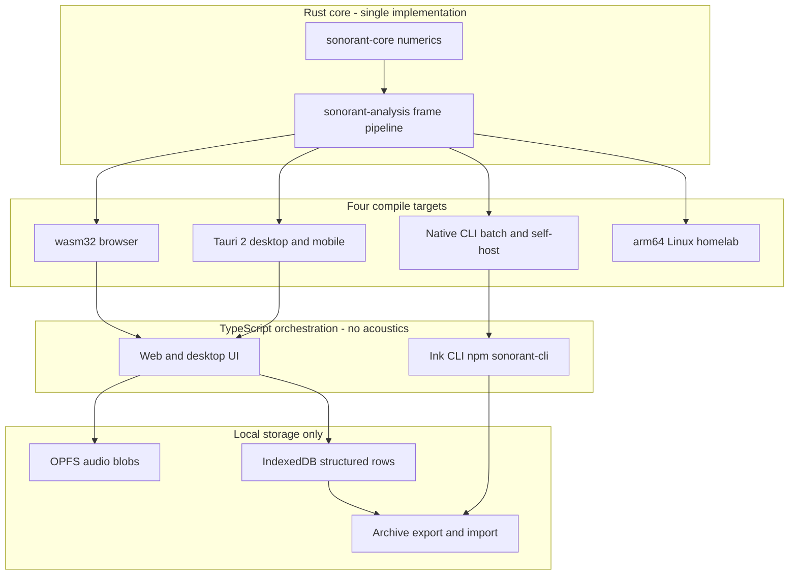

# RRF Phase 5 — Technical Architecture

**Status:** draft
**Tier:** lightweight (from `rrf-00-triage`)
**Owner:** solo builder, with clinical input from a volunteer SLP
**Phase:** 5 of the Risk Reduction Delivery Framework
**Inputs:** phase 3 workflows ([`docs/rrf/03-rough-workflows.md`](03-rough-workflows.md)); phase 4 risk & constraints ([`docs/rrf/04-risk-constraints.md`](04-risk-constraints.md)); TDD §3, §4, §7, §8, §9, §11, §12; brief §5, §6, §10
**Output feeds:** phase 6 (final designs), phase 7 (story breakdown), phase 8 (testing), phase 10 (deploy)

---

## Purpose

This is the phase-5 deliverable at the lightweight tier. Its job is threefold:

1. **Confirm** the authoritative architecture covers the phase-5 must-answer checklist.
2. **Draft** the interface and data contracts strictly enough that the two TypeScript surfaces (the web/desktop UI and the Ink CLI) and the Rust core can be built against the same shapes.
3. **Cross-check** the phase-4 risk register: every mitigation that needs an architectural mechanism should have a home in the design.

**The TDD is authoritative.** This document does not restate the architecture; it points at it, answers the checklist against it, and drafts the contracts the TDD describes but does not write out as schemas. Where this document paraphrases the TDD, the TDD is authoritative. Where this document drafts something the TDD leaves open, it is **marked as a proposed draft needing confirmation**.

**There is no HTTP API and no backend.** The "service/interface boundaries" here are the Rust core's `Analyzer` / `Engine` contract, the `AnalysisFrame` wire layout, the archive container format, and the local storage schema. No REST endpoints are invented, because none exist. Where the phase-5 checklist asks about RBAC, audit logging, rate limits, or server-side concerns, the answer is **N/A — no server, no tenancy** (TDD §12), stated explicitly rather than left blank.

---

## 1. Architecture summary and pointer

**Authoritative document:** [`docs/TDD — Rust analysis core & local-first deployment.md`](../TDD%20%E2%80%94%20Rust%20analysis%20core%20%26%20local-first%20deployment.md). Read it in full; this phase does not supersede it.

**The four-target single-core approach, in a few lines.** The acoustic maths is written once, in Rust, in `sonorant-core` and `sonorant-analysis` — pure, portable, no I/O, `#![forbid(unsafe_code)]`. That one implementation compiles to four targets: `wasm32-unknown-unknown` for the browser, native desktop and mobile via Tauri 2, a native CLI for batch and self-hosted use, and arm64 Linux for a homelab host. TypeScript is the UI and orchestration layer only, and computes no acoustics — not even a fallback path. Both TypeScript surfaces (the web/desktop UI and the Ink CLI) drive the core through the same `Analyzer` / `Engine` contract. There is no server component in v1, and no network client exists anywhere in the dependency graph. (TDD §1, §3.)



**Interface boundaries.** Four boundaries carry contracts, and all four are local:

| Boundary | Contract | Where defined |
|---|---|---|
| Core ↔ TypeScript surfaces | `Analyzer` / `Engine` trait and FFI surface | TDD §4.1, §4.3 |
| Core ↔ JS reader | `AnalysisFrame` wire layout, `CORE_ABI_VERSION` | TDD §4.4, §9.5 |
| App ↔ archive file | ZIP container, `manifest.json`, `payload.enc` | TDD §8 |
| App ↔ local store | `session`, `utterance`, `metric_series`, `calibration`, `measure_version` | TDD §7.1 |

---

## 2. Must-answer checklist

Each item is answered explicitly, citing the TDD section that satisfies it, or marked **N/A** with the reason.

### 2.1 Interface boundaries and the contracts crossing them

**Answered.** Four boundaries, all local, no network. The contracts are the `Analyzer` / `Engine` trait (TDD §4.1, §4.3), the `AnalysisFrame` wire layout versioned by `CORE_ABI_VERSION` (TDD §4.4), the archive container (TDD §8), and the local storage schema (TDD §7.1). Drafts of the data contracts are in §3 and §4 below. There is no HTTP API and no service tier, so no OpenAPI document exists or is needed (TDD §17).

### 2.2 Schema changes and migration rollout / rollback

**Answered — TDD §7.2.** Forward-only, expand/contract, on both the local store and the archive container. Because there is no server, "rollback" means serving the previous static bundle; the previous release artifact is retained and restoring it is a documented one-command operation. The load-bearing rule: **a schema change must be readable by the immediately previous release, or it must be accompanied by an archive export prompt — users must never be stuck with data they cannot open.** Every migration ships with a fixture store at the previous version, and CI runs the migration against it. Import handles version skew through the same migration ladder; an archive from a newer format version is refused with a clear message rather than partially parsed (TDD §8).

### 2.3 RBAC

**N/A — no server, no tenancy.** There is no server component, no account system, and no multi-tenant isolation. TDD §12 states multi-tenant isolation, server-side authz, and audit trails are explicitly out of scope, and that if a backend is ever added the entire security review is void and the whole design must be revisited. The only access boundary is the device's own OS-level access control and the archive passphrase (TDD §8, §12).

### 2.4 Audit logging

**N/A — no server.** There is no server and no tenancy, so there is no audit trail (TDD §12). The **local diagnostics panel is not an audit log**: it is a user-facing view of analysis latency, capture dropout, confidence aggregates, input-integrity warnings, and version strings, and it is never transmitted (TDD §11). The "copy diagnostics" action produces a redacted blob containing counters, timings, and version strings — **no measurements and no audio** — and the redaction is part of the function, not a user responsibility (TDD §11).

### 2.5 Observability / monitoring thresholds

**Answered — TDD §11.** Diagnostics replace operational observability, because there are no operations. Thresholds are surfaced in-app rather than alerted on, and diagnostics are **never transmitted** — there is no telemetry, no crash reporter, and no analytics SDK, and no network client exists in the dependency graph.

| Signal | Threshold | What it means to the member |
|---|---|---|
| Analysis latency p95 | > 20 ms | the device is struggling; suggest lower resolution |
| Capture dropout | > 0.5% of frames | another app is contending for audio |
| Mean formant confidence | < 0.6 | results are not trustworthy; usually a mic or room problem |
| Voicing confidence p05 | < 0.4 | input or environment problem |
| Input-integrity warnings | > 3 per session | the mic path is compromised |

### 2.6 Caching

**Answered — TDD §7.** The local store *is* the cache, and it is the only store. OPFS holds audio blobs; IndexedDB holds structured rows. Audio is written only if the member has recording enabled; otherwise frames are analysed and discarded in memory. Both stores are keyed by the same versioning fields as the archive format, because the local store and the export are the same data in two containers. There is no server-side cache, no CDN cache of user data, and no shared cache — nothing leaves the device.

### 2.7 Rate limits

**N/A — no server.** There is no server, no endpoint, and no shared resource to protect. The only rate-like constraint is the real-time audio budget: the audio callback runs under a hard real-time budget, so capture happens in the callback and analysis happens on a worker (TDD §6.1). That is a scheduling constraint, not a rate limit.

### 2.8 Expected load

**Answered.** Single-user, local, real-time. At 44.1 kHz with `frame_len` 2048 and `hop` 512, the frame rate is approximately **86 frames per second** (TDD §4.1). Load is one member on one device; there is no concurrency, no fan-out, and no multi-tenant scaling question. The relevant budget is per-frame analysis latency, whose p95 threshold is 20 ms (TDD §11).

---

## 3. Contract drafts

These are JSON Schema (draft 2020-12) drafts of the data contracts. The **identifiers and field names are taken exactly from the TDD §4.1 and §8**. The JSON schemas describe the *logical* contract used by the archive and the local rows; the *binary* wire layout is separate and is noted in §3.7.

> **Note on `NaN`.** JSON has no `NaN` literal. The TDD specifies `spl_db` is `NaN` when uncalibrated (TDD §4.2). The JSON representation of that state is an open item — see §6. The schema below marks `spl_db` as nullable to make the uncalibrated state representable, and flags the convention as needing confirmation.

### 3.1 `Formant`

```json
{
  "$schema": "https://json-schema.org/draft/2020-12/schema",
  "$id": "https://sonorant.dev/schemas/formant.json",
  "title": "Formant",
  "description": "One formant pole. Mirrors the Rust Formant struct in TDD 4.1.",
  "type": "object",
  "additionalProperties": false,
  "required": ["hz", "bandwidth_hz", "confidence"],
  "properties": {
    "hz": {
      "type": "number",
      "description": "Formant centre frequency in Hz."
    },
    "bandwidth_hz": {
      "type": "number",
      "description": "Formant bandwidth in Hz."
    },
    "confidence": {
      "type": "number",
      "minimum": 0,
      "maximum": 1,
      "description": "0..1. Prominence of the pole above the local envelope floor, tempered by pole stability across neighbouring frames."
    }
  }
}
```

### 3.2 `AnalysisFrame`

```json
{
  "$schema": "https://json-schema.org/draft/2020-12/schema",
  "$id": "https://sonorant.dev/schemas/analysis-frame.json",
  "title": "AnalysisFrame",
  "description": "One analysis frame. Logical JSON contract; the binary wire layout is a fixed-stride Float32Array view (TDD 4.4).",
  "type": "object",
  "additionalProperties": false,
  "required": [
    "t_ms", "f0_hz", "voicing", "f0_confidence", "formants",
    "hnr_db", "cpp_db", "tilt_db_per_oct", "h1_h2_db", "centroid_hz",
    "scale_semitones", "rms_dbfs", "spl_db", "jitter_local", "shimmer_local", "flags"
  ],
  "properties": {
    "t_ms": {
      "type": "integer",
      "minimum": 0,
      "maximum": 4294967295,
      "description": "Milliseconds since session start (u32)."
    },
    "f0_hz": {
      "type": "number",
      "description": "Fundamental frequency in Hz. A value <= 0.0 means unvoiced."
    },
    "voicing": {
      "type": "number",
      "minimum": 0,
      "maximum": 1,
      "description": "Voicing strength, 0..1."
    },
    "f0_confidence": {
      "type": "number",
      "minimum": 0,
      "maximum": 1,
      "description": "Confidence in the F0 estimate, 0..1."
    },
    "formants": {
      "type": "array",
      "maxItems": 5,
      "items": { "$ref": "https://sonorant.dev/schemas/formant.json" },
      "description": "Up to MAX_FORMANTS = 5 formant poles."
    },
    "hnr_db": {
      "type": "number",
      "description": "Harmonics-to-noise ratio in dB."
    },
    "cpp_db": {
      "type": "number",
      "description": "Cepstral peak prominence in dB."
    },
    "tilt_db_per_oct": {
      "type": "number",
      "description": "Long-term average spectral tilt in dB per octave."
    },
    "h1_h2_db": {
      "type": "number",
      "description": "H1-H2 difference in dB; vocal-weight proxy."
    },
    "centroid_hz": {
      "type": "number",
      "description": "Spectral centroid in Hz."
    },
    "scale_semitones": {
      "type": "number",
      "description": "Vowel-independent formant scale in semitones, relative to this session's own baseline. Negative means larger apparent tract. Computed in the core, not the UI."
    },
    "rms_dbfs": {
      "type": "number",
      "description": "RMS level in dBFS."
    },
    "spl_db": {
      "type": ["number", "null"],
      "description": "Sound pressure level in dB SPL. NaN (represented as null in JSON) unless a calibration is active. Not zero, not an estimate."
    },
    "jitter_local": {
      "type": "number",
      "description": "Local jitter."
    },
    "shimmer_local": {
      "type": "number",
      "description": "Local shimmer."
    },
    "flags": {
      "type": "integer",
      "minimum": 0,
      "maximum": 65535,
      "description": "Bitfield of the flags enum, stored as an f32 bitfield on the wire. See 3.5."
    }
  }
}
```

### 3.3 `AnalysisParams`

```json
{
  "$schema": "https://json-schema.org/draft/2020-12/schema",
  "$id": "https://sonorant.dev/schemas/analysis-params.json",
  "title": "AnalysisParams",
  "description": "Configuration for the Analyzer. Mirrors the Rust AnalysisParams struct in TDD 4.1.",
  "type": "object",
  "additionalProperties": false,
  "required": [
    "sample_rate", "frame_len", "hop", "pre_emphasis",
    "lpc_order", "max_formant_hz", "voicing_threshold"
  ],
  "properties": {
    "sample_rate": {
      "type": "integer",
      "minimum": 1,
      "description": "Sample rate in Hz."
    },
    "frame_len": {
      "type": "integer",
      "minimum": 1,
      "default": 2048,
      "description": "Analysis frame length in samples. Default 2048."
    },
    "hop": {
      "type": "integer",
      "minimum": 1,
      "default": 512,
      "description": "Hop size in samples. Default 512 at 44.1 kHz, giving approximately 86 frames per second."
    },
    "pre_emphasis": {
      "type": "number",
      "default": 0.97,
      "description": "Pre-emphasis coefficient. Default 0.97."
    },
    "lpc_order": {
      "type": "integer",
      "minimum": 1,
      "description": "LPC order. Computed as clamp(2 + sample_rate/1000, 18, 24)."
    },
    "max_formant_hz": {
      "type": "number",
      "default": 5500,
      "description": "Upper bound for formant search in Hz. Default 5500."
    },
    "voicing_threshold": {
      "type": "number",
      "description": "Voicing decision threshold."
    }
  }
}
```

### 3.4 `AnalysisSummary` — PROPOSED DRAFT, NEEDS CONFIRMATION

> **This structure is not defined in the TDD.** The TDD references `AnalysisSummary` only as the content of `utterance.metrics_json` (TDD §7.1). The structure below is a **proposed draft** derived from the measures the TDD and brief name, and it **must be confirmed before it is treated as a contract**. It is the single largest open item this phase surfaces (see §6).

```json
{
  "$schema": "https://json-schema.org/draft/2020-12/schema",
  "$id": "https://sonorant.dev/schemas/analysis-summary.json",
  "title": "AnalysisSummary",
  "description": "PROPOSED DRAFT - not defined in the TDD. Per-utterance aggregate stored in utterance.metrics_json. Needs confirmation.",
  "type": "object",
  "additionalProperties": false,
  "required": [
    "core_version", "duration_ms", "voiced_fraction",
    "f0", "formants", "scale_semitones",
    "hnr_db", "cpp_db", "tilt_db_per_oct", "h1_h2_db", "centroid_hz",
    "rms_dbfs", "spl_db", "jitter_local", "shimmer_local",
    "confidence", "flag_counts"
  ],
  "properties": {
    "core_version": {
      "type": "string",
      "description": "The CORE_VERSION that produced this summary. Required so trends can be marked across a version boundary (TDD 9)."
    },
    "duration_ms": {
      "type": "integer",
      "minimum": 0,
      "description": "Utterance duration in milliseconds."
    },
    "voiced_fraction": {
      "type": "number",
      "minimum": 0,
      "maximum": 1,
      "description": "Fraction of frames classified voiced."
    },
    "f0": { "$ref": "#/$defs/StatBlock" },
    "formants": {
      "type": "array",
      "maxItems": 5,
      "items": { "$ref": "#/$defs/StatBlock" },
      "description": "Per-formant aggregate statistics, in formant order."
    },
    "scale_semitones": { "$ref": "#/$defs/StatBlock" },
    "hnr_db": { "$ref": "#/$defs/StatBlock" },
    "cpp_db": { "$ref": "#/$defs/StatBlock" },
    "tilt_db_per_oct": { "$ref": "#/$defs/StatBlock" },
    "h1_h2_db": { "$ref": "#/$defs/StatBlock" },
    "centroid_hz": { "$ref": "#/$defs/StatBlock" },
    "rms_dbfs": { "$ref": "#/$defs/StatBlock" },
    "spl_db": {
      "oneOf": [
        { "$ref": "#/$defs/StatBlock" },
        { "type": "null" }
      ],
      "description": "Null unless a calibration is active."
    },
    "jitter_local": { "$ref": "#/$defs/StatBlock" },
    "shimmer_local": { "$ref": "#/$defs/StatBlock" },
    "confidence": {
      "type": "object",
      "additionalProperties": false,
      "required": ["mean_formant", "voicing_p05"],
      "properties": {
        "mean_formant": {
          "type": "number",
          "minimum": 0,
          "maximum": 1,
          "description": "Mean formant confidence across the utterance. Threshold < 0.6 is a warning (TDD 11)."
        },
        "voicing_p05": {
          "type": "number",
          "minimum": 0,
          "maximum": 1,
          "description": "5th-percentile voicing confidence. Threshold < 0.4 is a warning (TDD 11)."
        }
      }
    },
    "flag_counts": {
      "type": "object",
      "additionalProperties": false,
      "description": "Count of frames carrying each flag.",
      "properties": {
        "CLIPPED": { "type": "integer", "minimum": 0 },
        "LOW_SNR": { "type": "integer", "minimum": 0 },
        "CREAK": { "type": "integer", "minimum": 0 },
        "SUBHARMONIC": { "type": "integer", "minimum": 0 },
        "FORMANT_UNSTABLE": { "type": "integer", "minimum": 0 },
        "UNCALIBRATED": { "type": "integer", "minimum": 0 }
      }
    }
  },
  "$defs": {
    "StatBlock": {
      "type": "object",
      "additionalProperties": false,
      "required": ["median", "p05", "p95", "mean"],
      "properties": {
        "median": { "type": "number" },
        "p05": { "type": "number" },
        "p95": { "type": "number" },
        "mean": { "type": "number" }
      }
    }
  }
}
```

### 3.5 Flags enum

The flags are an `f32` bitfield (TDD §4.1). The JSON schema below is the enum of bit values; the wire representation is the f32 bitfield.

```json
{
  "$schema": "https://json-schema.org/draft/2020-12/schema",
  "$id": "https://sonorant.dev/schemas/flags.json",
  "title": "AnalysisFlags",
  "description": "f32 bitfield. Values mirror the flags module in TDD 4.1.",
  "type": "integer",
  "minimum": 0,
  "maximum": 65535,
  "x-enum-bit-values": {
    "CLIPPED": 1,
    "LOW_SNR": 2,
    "CREAK": 4,
    "SUBHARMONIC": 8,
    "FORMANT_UNSTABLE": 16,
    "UNCALIBRATED": 32
  }
}
```

| Flag | Bit | Value | Meaning |
|---|---|---|---|
| `CLIPPED` | 0 | 1 | Input clipped |
| `LOW_SNR` | 1 | 2 | Low signal-to-noise ratio |
| `CREAK` | 2 | 4 | Creaky voice detected |
| `SUBHARMONIC` | 3 | 8 | Subharmonic error suspected |
| `FORMANT_UNSTABLE` | 4 | 16 | Formant estimate unstable across neighbouring frames |
| `UNCALIBRATED` | 5 | 32 | No active calibration; `spl_db` is `NaN` |

### 3.6 Archive `manifest.json`

```json
{
  "$schema": "https://json-schema.org/draft/2020-12/schema",
  "$id": "https://sonorant.dev/schemas/archive-manifest.json",
  "title": "ArchiveManifest",
  "description": "Plaintext manifest.json inside the voice-history ZIP container (TDD 8). Deliberately readable without a passphrase.",
  "type": "object",
  "additionalProperties": false,
  "required": [
    "format", "format_version", "schema_version", "core_version",
    "abi_version", "created_at", "encrypted", "kdf", "counts"
  ],
  "properties": {
    "format": {
      "const": "voice-history",
      "description": "Container format identifier."
    },
    "format_version": {
      "type": "integer",
      "minimum": 1,
      "description": "Archive container format version. A newer value than the app supports is refused with a clear message."
    },
    "schema_version": {
      "type": "integer",
      "minimum": 1,
      "description": "Local store schema version this archive was written against."
    },
    "core_version": {
      "type": "string",
      "description": "CORE_VERSION that produced the measurements."
    },
    "abi_version": {
      "type": "integer",
      "minimum": 1,
      "description": "CORE_ABI_VERSION of the memory layout."
    },
    "created_at": {
      "type": "string",
      "format": "date-time",
      "description": "ISO 8601 timestamp."
    },
    "encrypted": {
      "type": "boolean",
      "description": "Whether payload.enc is encrypted. Encrypted by default; plaintext is an explicit, warned choice."
    },
    "kdf": {
      "type": "object",
      "additionalProperties": false,
      "required": ["algo", "m", "t", "p"],
      "properties": {
        "algo": { "const": "argon2id" },
        "m": { "type": "integer", "minimum": 1, "description": "Memory cost in KiB." },
        "t": { "type": "integer", "minimum": 1, "description": "Time cost (iterations)." },
        "p": { "type": "integer", "minimum": 1, "description": "Parallelism." }
      }
    },
    "counts": {
      "type": "object",
      "additionalProperties": false,
      "required": ["sessions", "utterances", "recordings"],
      "properties": {
        "sessions": { "type": "integer", "minimum": 0 },
        "utterances": { "type": "integer", "minimum": 0 },
        "recordings": { "type": "integer", "minimum": 0 }
      }
    }
  }
}
```

### 3.7 Wire layout note

`AnalysisFrame` is a fixed-size struct read on the JS side as a `Float32Array` over `memory.buffer`, with a stride of **30 words** and the field order in TDD §4.1. The layout is versioned with `CORE_ABI_VERSION`; a mismatch between the JS reader and the core is a **hard startup failure**, not a silent misread (TDD §4.4, §9.5). The shipped `.wasm` hash is recorded and compared at startup; a mismatch is a hard failure (TDD §12).

> **Resolved.** TDD §4.4 previously stated the struct was "25 `f32`s plus one `u32`" (26 words), which did not reconcile with the field list in TDD §4.1. The layout is now fixed at **28 `f32` + `t_ms` (`u32`) + `flags` (`f32` bitfield) = 30 words** (29 `f32` + 1 `u32`), with a stride of 30 words. The `flags` field is an `f32` bitfield, not a separate integer type. The wire layout is a one-way contract (OW-6), so the ABI test asserts this exact stride.

---

## 4. Storage schema

Reproduced from TDD §7.1. Both stores are keyed by the same versioning fields as the archive format, because the local store and the export are the same data in two containers. Shown as SQL for clarity; mirrored in IndexedDB object stores.

```sql
-- mirrored in IndexedDB object stores; shown as SQL for clarity
CREATE TABLE session (
  id              TEXT PRIMARY KEY,
  started_at      INTEGER NOT NULL,
  ended_at        INTEGER,
  device_class    TEXT NOT NULL,     -- web | tauri-desktop | tauri-mobile | cli
  calibration_id  TEXT,              -- NULL => SPL values are NULL, not zero
  app_version     TEXT NOT NULL,
  core_version    TEXT NOT NULL,
  abi_version     INTEGER NOT NULL,
  schema_version  INTEGER NOT NULL
);

CREATE TABLE utterance (
  id            TEXT PRIMARY KEY,
  session_id    TEXT NOT NULL REFERENCES session(id) ON DELETE CASCADE,
  kind          TEXT NOT NULL,       -- sustained | phrase | glide | ddk | mpt
  phoneme_set   TEXT,
  duration_ms   INTEGER NOT NULL,
  metrics_json  TEXT NOT NULL,       -- AnalysisSummary
  created_at    INTEGER NOT NULL
);

CREATE TABLE metric_series (         -- downsampled for trend charts
  utterance_id  TEXT NOT NULL REFERENCES utterance(id) ON DELETE CASCADE,
  channel       TEXT NOT NULL,       -- f0 | scale | hnr | cpp | spl | stability
  t_ms          INTEGER NOT NULL,
  value         REAL NOT NULL,
  confidence    REAL NOT NULL,
  PRIMARY KEY (utterance_id, channel, t_ms)
);

CREATE TABLE calibration (
  id                       TEXT PRIMARY KEY,
  device_class             TEXT NOT NULL,
  mic_model                TEXT,
  sensitivity_dbfs_at_94db REAL NOT NULL,
  method                   TEXT NOT NULL,   -- calibrator | reference_tone
  measured_at              INTEGER NOT NULL
);

CREATE TABLE measure_version (     -- one row per core version that produced stored data
  core_version  TEXT PRIMARY KEY,
  introduced_at INTEGER NOT NULL,
  notes         TEXT
);
```

**Notes carried from the TDD.** `calibration_id` is `NULL` when there is no calibration, and in that case SPL values are `NULL`, not zero (TDD §7.1, §13). `metrics_json` holds the `AnalysisSummary` — whose structure is the proposed draft in §3.4. `measure_version` is the table that makes the measure-versioning policy (OW-1) enforceable: every stored record carries the `core_version` that produced it (TDD §9).

---

## 5. Risk-register cross-check

For each mitigation in [`docs/rrf/04-risk-constraints.md`](04-risk-constraints.md) that needs an architectural mechanism, this confirms the mechanism appears in the design. The right-hand column names the architectural home.

| Mitigation (phase 4) | Architectural home | Status |
|---|---|---|
| CSP `connect-src 'none'` — no endpoint to talk to | TDD §12 | Confirmed |
| CI bundle origin scan — fails the build on any external origin | TDD §12, §14 | Confirmed |
| No third-party scripts, analytics, or error-reporting SDK | TDD §12 | Confirmed |
| `frame-ancestors 'none'` — anti-framing | TDD §12 | Confirmed |
| Shipped `.wasm` hash recorded and compared at startup; mismatch is a hard failure | TDD §12 | Confirmed |
| `cargo-deny` licence and advisory gates, `cargo-audit`, `deny.toml` allowlist | TDD §5, §12 | Confirmed |
| SBOM and provenance attestations on published artifacts | TDD §12, §15 | Confirmed |
| Migration ladder — forward-only expand/contract, on local store and archive | TDD §7.2, §8 | Confirmed |
| Rollback safety rule — previous release must read the schema, or export prompt | TDD §7.2, §10 | Confirmed |
| Migration fixture store at the previous version, run in CI | TDD §7.2, §14 | Confirmed |
| `CORE_ABI_VERSION` check — hard startup failure on mismatch | TDD §4.4, §9.5 | Confirmed |
| ABI test — JS reader against the core layout, fails CI | TDD §14 | Confirmed |
| Archive `format_version` check — refuse newer format cleanly | TDD §8 | Confirmed |
| XChaCha20-Poly1305 AEAD — wrong passphrase and truncation fail cleanly | TDD §8, §14 | Confirmed |
| Archive round-trip tests with version skew both directions | TDD §14 | Confirmed |
| Measure-versioning policy — stored `core_version`, chart boundary marking | TDD §9 | Confirmed |
| Conformance fixtures with per-measure tolerance bands | TDD §14 | Confirmed |
| In-house core tuned for high F0; confidence not displayable-free | TDD §1, §4.2 | Confirmed |
| Analyse on a worker, never under the real-time audio budget | TDD §6.1 | Confirmed |
| Copy-to-ring-buffer hand-off; surface the dropout warning | TDD §6.1, §11 | Confirmed |
| Mandatory `getUserMedia` constraints; log rather than absorb | TDD §6.1 | Confirmed |
| Diagnostics audio-path properties (sample rate, channel count, processing applied) | TDD §11 | Confirmed |
| Redaction is part of the diagnostics function, not a user task | TDD §11, §12 | Confirmed |
| No acoustic maths in TypeScript; single shared `Analyzer` / `Engine` contract | TDD §1, §3, §4 | Confirmed |
| Capture-shim conformance fixtures across both surfaces | TDD §6, §14 | Confirmed |
| All artifacts built from one commit and one `CORE_VERSION` | TDD §15 | Confirmed |
| Keep the previous release artifact as the rollback strategy | TDD §7.2, §10, §15 | Confirmed |
| HTTPS mandatory; `localhost` counts as secure; document self-signed / local-CA workflow | TDD §10 | Confirmed |
| Secure-context check before requesting the microphone | TDD §10; phase 3 flow 1 | Confirmed |
| No-backend boundary written in brief and TDD | TDD §1, §12; brief §5 principle 8 | Confirmed |
| `spl_db` is `NaN` without calibration; SPL features gated on `calibration_id IS NOT NULL` | TDD §4.2, §13 | Confirmed |
| Per-formant confidence; `FORMANT_UNSTABLE` flag | TDD §4.1, §4.2 | Confirmed |
| Self-referential baseline; normative bands off by default | TDD §4.2; brief §5 principle 4 | Confirmed |

### 5.1 Mitigations with no architectural home

Two items from the phase-4 register have **no architectural mechanism** in the current design. Both are recorded in phase 4 as explicit unknowns, and both are carried forward here rather than silently dropped.

| Mitigation (phase 4) | Status | Note |
|---|---|---|
| **Build-toolchain / registry offline strategy** — no vendoring or offline-build approach is specified | **No architectural home** | Phase 4 §3.3 and §7.7 record this as a gap surfaced by the dependency sweep, not stated in the TDD. The TDD specifies no vendoring or offline-build strategy. This phase confirms the gap: there is no mechanism in the design that makes a build possible when the registry is unavailable. |
| **Commercial re-absorption under Unlicense** | **No architectural home — accepted** | Phase 4 §5 records the mitigation as non-technical: publish methodology, measurement docs, and conformance fixtures; trust and community; signed releases. There is no architectural mechanism, and none is intended — the decision is accepted (OW-3). |

Everything else in the phase-4 register maps to a mechanism that exists in the TDD. The two items above are the only ones without an architectural home, and both are already flagged as unknowns or accepted costs in phase 4.

---

## 6. Open items

Items the TDD leaves open that this phase surfaces, plus discrepancies this phase found. Each is marked with its source.

1. **`AnalysisSummary` structure — PROPOSED, needs confirmation.** The TDD references `AnalysisSummary` as the content of `utterance.metrics_json` (TDD §7.1) but does not define it. The draft in §3.4 is proposed and must be confirmed before it is treated as a contract. This is the largest open item this phase surfaces. (TDD §7.1; this document §3.4.)
2. **JSON representation of `spl_db` `NaN`.** The TDD specifies `spl_db` is `NaN` when uncalibrated (TDD §4.2), but JSON has no `NaN` literal. The schema in §3.2 uses `null`; the convention needs confirmation, and it must be consistent between the archive and the local rows. (TDD §4.2, §7.1, §8.)
3. **Argon2id parameters for the archive KDF.** `m`, `t`, `p` need a decision against an explicit device-class time budget, since a phone must open its own archive in reasonable time. The parameters are recorded per archive in `manifest.json`, so they are a two-way door (TW-7). (TDD §8, §16.5; phase 4 §1.2.)
4. **SQLite versus IndexedDB for the local store.** Deferred because IndexedDB handles the current row shapes and avoids a second storage engine. The schema is the contract, not the engine, so this can be adopted behind the storage layer without changing the archive format. (TDD §7, §16.6; phase 4 TW-2.)
5. **Unverified dependency licences.** `pitch-detection`, `pyin-rs`, `hound`, `symphonia`, `zip`, and both prior-art voice crates (`loqa-voice-dsp`, `syne_audio_dsp`) are unverified and must be verified before any becomes a dependency. `symphonia` is MPL-2.0 and needs an explicit exception comment if used unmodified. (TDD §5, §16.1; phase 4 §2.1.)
6. **Build-toolchain / registry offline strategy.** No vendoring or offline-build approach is specified. Confirmed here as a mitigation with no architectural home (§5.1). (Phase 4 §3.3, §7.7.)
7. **Whether the desktop shell ships in v1.** If yes, `sonorant-capture` and the calibration flow move into the critical path rather than staying deferred. (TDD §16.4; brief §12.2; phase 4 TW-4.)
8. **Phoneme classifier for per-vowel analysis.** Build in Rust, vendor, or defer past v1. (TDD §16.3; brief §12.3.)
9. **Specific microphone and calibrator pairing.** A separate equipment research pass with cited sources. The category is verified (Class 1, IEC 60942, 1 kHz at 94 dB, ½″ couplers, ¼″ adapters), but a specific pairing is not. (TDD §13, §16.2; brief §12.1.)

> **Resolved since the previous revision.** The `AnalysisFrame` wire-layout arithmetic discrepancy (previously item 2) is resolved: the layout is **28 `f32` + `t_ms` (`u32`) + `flags` (`f32` bitfield) = 30 words** (29 `f32` + 1 `u32`), stride 30 words. See §3.7. (TDD §4.1, §4.4.)

---

## Source

- [`docs/TDD — Rust analysis core & local-first deployment.md`](../TDD%20%E2%80%94%20Rust%20analysis%20core%20%26%20local-first%20deployment.md) — architecture (§3), core contract and wire layout (§4), dependency register (§5), capture constraints (§6), storage and migrations (§7), export/import (§8), measure versioning and ABI stability (§9), deployment and rollback (§10), diagnostics thresholds (§11), security review (§12), calibration (§13), testing (§14), build and release (§15), open questions (§16), what this document does not contain (§17).
- [`docs/Project brief — voice analysis & training tool.md`](../Project%20brief%20%E2%80%94%20voice%20analysis%20%26%20training%20tool.md) — principles (§5), scope (§6), claims/ethics (§8), operator story (§10), open questions (§12), non-goals (§13).
- [`docs/rrf/04-risk-constraints.md`](04-risk-constraints.md) — decision inventory (§1), dependency sweep (§2), failure modes (§3), blast radius (§4), risk register (§5), risk & rollback strategy (§6), unanswered questions (§7).
- [`docs/rrf/03-rough-workflows.md`](03-rough-workflows.md) — flows and edge-case dispositions this document builds on.
- [`docs/rrf/01-ideation-intake.md`](01-ideation-intake.md) — phase 1 problem statement.
- [`docs/rrf/02-five-whys-context.md`](02-five-whys-context.md) — phase 2 context.
