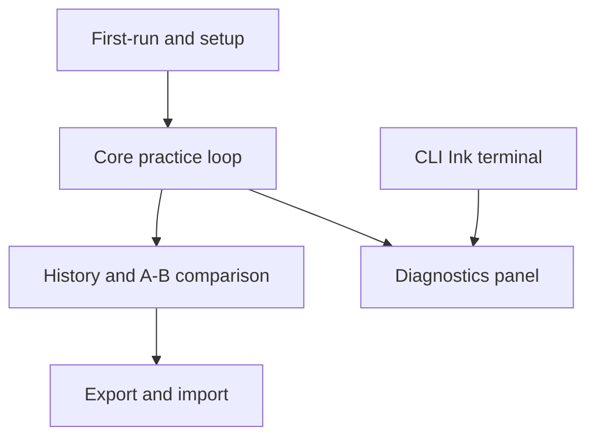

# RRF Phase 6 — Finalize Designs

**Status:** draft
**Tier:** lightweight (from `rrf-00-triage`)
**Owner:** solo builder, with clinical input from a volunteer SLP
**Phase:** 6 of the Risk Reduction Delivery Framework
**Inputs:** phase 3 workflows ([`docs/rrf/03-rough-workflows.md`](03-rough-workflows.md)); phase 5 architecture ([`docs/rrf/05-technical-architecture.md`](05-technical-architecture.md)); brief §5, §6, §7, §8, §10; TDD §4, §6, §7, §8, §9, §10, §11, §12, §13
**Output feeds:** phase 7 (story breakdown), phase 8 (testing), phase 9 (demos)

---

## Purpose

This is the phase-6 deliverable at the lightweight tier. It refines the phase-3 flows into
development-ready screen and interaction specs: for every screen and interaction, the
**standard**, **active**, and **error** states, the **copy**, and the **accessibility notes**.
It is written so an engineer can implement a story without asking what a state looks like or
what it says.

It also does the two things phase 6 exists to do beyond the checklist:

- **Cross-references** the screens against the phase-3 flows and the brief §7 Phase 1
  visualisation inventory, and lists the gaps.
- **Records feasibility-loop adjustments** — design choices that remove architectural
  complexity or risk — so the decision is traceable and phase 4/5 stay honest.

**Everything here traces to the brief or the TDD.** Where a string is not yet written, it is
marked `[PLACEHOLDER]`. Where a state is not specified in the source documents, it is listed
in §4 (Gaps) rather than invented.

**Boundary carried from the brief (§5, §8).** The tool measures and displays; it does not
classify, screen, or diagnose. No screen scores femininity, masculinity, or passability, and
none stores such a score. Normative comparison is off by default. Every estimate carries a
confidence indication, and nothing ships without a text summary.

---

## How to read this document

- **§1** is the screen/interaction inventory, derived from the phase-3 flows.
- **§2** is the per-screen checklist: standard / active / error states, copy, accessibility.
- **§3** maps the brief §7 Phase 1 visualisation inventory to the screens and names gaps.
- **§4** is the consolidated gaps list.
- **§5** is the feasibility loop.

Screen IDs are `S<group>.<n>`. Error branches carry the phase-3 edge-case name in brackets so
the cross-reference is explicit.

### Screen map

---

## 1. Screen / interaction inventory

Derived from the phase-3 flows. Each entry names the flow it comes from.

| ID | Screen / interaction | Source flow | Notes |
|---|---|---|---|
| S1.1 | Secure-context check | Phase 3 flow 1 | Gate before any microphone request |
| S1.2 | Microphone permission request | Phase 3 flow 1 | Mandatory constraints, not defaults |
| S1.3 | Input-integrity check | Phase 3 flow 1 | Logs warnings, does not block |
| S1.4 | Optional calibration | Phase 3 flow 1 | Per device and per mic; SPL stays blank without it |
| S2.1 | Exercise selection | Phase 3 flow 2 | Sustained, glide, resonance-hold, connected speech |
| S2.2 | Live two-axis pitch × resonance pad | Phase 3 flow 2 | Pitch and resonance always visually separable |
| S2.3 | Confidence indication | Phase 3 flow 2 | Every estimate carries one |
| S2.4 | Text summary | Phase 3 flow 2 | Nothing ships without it |
| S2.5 | Recording control | Phase 3 flow 2 | Opt-in; audio written only if enabled |
| S3.1 | History list | Phase 3 flow 3 | Rows from IndexedDB, audio from OPFS |
| S3.2 | A/B comparison view | Phase 3 flow 3 | Against the member's own past |
| S3.3 | Longitudinal trend / sparklines | Phase 3 flow 3 | Marks `core_version` boundary |
| S4.1 | Export options | Phase 3 flow 4 | Recordings opt-in, separately from measurements |
| S4.2 | Passphrase entry | Phase 3 flow 4 | Encrypted by default |
| S4.3 | Import merge report | Phase 3 flow 4 | Added / skipped / conflicted; never silent overwrite |
| S5.1 | CLI command output | Phase 3 flow 5 | Ink; orchestration only, no acoustics |
| S5.2 | CLI progress | Phase 3 flow 5 | Long-running batch analysis |
| S5.3 | CLI errors | Phase 3 flow 5 | Exit codes and messages |
| S6.1 | Diagnostics panel | TDD §11 | Local only; never transmitted |
| S6.2 | Copy diagnostics | TDD §11 | Redacted blob; no measurements, no audio |

---

## 2. Per-screen state / copy / accessibility checklist

Each screen lists **standard**, **active**, and **error** states, the **copy**, and
**accessibility notes**. Copy is plain language (target: 8th grade or below for general copy).
Copy follows the inclusive-software rules: no blame, no urgency, no trauma triggers.

**Global accessibility baseline (applies to every screen, not repeated in full below):**

- WCAG 2.2 Level AA minimum. Body text contrast ≥ 4.5:1; large text and UI components ≥ 3:1.
- Never convey information by colour alone. The two-axis pad, confidence overlays, flag
  indicators, and trend boundaries each carry a non-colour channel (shape, pattern, label,
  or text).
- Interactive targets ≥ 24×24 CSS px; prefer 44×44.
- Every interactive element is keyboard reachable with a visible focus indicator (≥ 3:1
  contrast, ≥ 2 CSS px perimeter). No keyboard traps.
- `prefers-reduced-motion` is respected: no animation is required to read a value; motion is
  gated on `no-preference`.
- Programmatic labels on every control; inline errors linked with `aria-describedby`.
- **The brief's rule — nothing ships without a text summary, and nothing ships without a
  confidence indication — is the primary non-visual accommodation.** The text summary is the
  accessible equivalent of the visualisation, not a secondary feature. A screen reader user
  gets the same information from the summary and the confidence text that a sighted user gets
  from the pad.

---

### S1.1 — Secure-context check

**Source:** phase 3 flow 1; TDD §10; brief §10.

| State | What the member sees |
|---|---|
| Standard | A brief startup check. On success it advances to S1.2 with no visible interruption. |
| Active | A short "Checking your connection" line while the check runs. |
| Error | A blocking panel: the app cannot use the microphone without a secure context. |

**Copy**

- Standard (transient): `Checking your connection…`
- Error heading: `This page needs a secure connection`
- Error body: `The microphone only works over HTTPS. Open the app over HTTPS, or use localhost for local development. Nothing is recorded until this is fixed.`
- Error action: `Reload`

**Accessibility notes**

- The error panel is a `role="alert"` region so it is announced when it appears.
- The error is not conveyed by colour alone; it carries a heading and text.
- The `Reload` control is a real `<button>`, keyboard reachable, ≥ 44×44 CSS px.
- No motion is required to read the error.

---

### S1.2 — Microphone permission request

**Source:** phase 3 flow 1; TDD §6.1.

| State | What the member sees |
|---|---|
| Standard | A short explanation of why the microphone is needed, then the browser's own permission prompt. |
| Active | "Waiting for your browser" while the prompt is open. |
| Error | Permission denied: guidance, not a dead end. The tool cannot capture without the microphone. |

**Copy**

- Standard heading: `This app needs your microphone`
- Standard body: `Audio is analysed on your device. Nothing is sent anywhere. You can turn recording off at any time.`
- Standard action: `Allow microphone`
- Active: `Waiting for your browser…`
- Error heading: `The microphone is blocked`
- Error body: `Your browser is not sharing audio with this app. To continue, allow microphone access for this site in your browser settings, then reload. Nothing has been recorded.`
- Error action: `Try again`

**Accessibility notes**

- The permission explanation is text, not an icon-only affordance.
- The browser prompt is the platform control; the app does not build a custom permission
  widget (inclusive-software R0.5 — prefer framework-provided controls).
- The error is announced via `role="alert"`; the `Try again` button is keyboard reachable.
- The mandatory `getUserMedia` constraints (`echoCancellation: false`,
  `noiseSuppression: false`, `autoGainControl: false`, `channelCount: 1`) are applied by the
  app, not surfaced as a member choice (TDD §6.1).

---

### S1.3 — Input-integrity check

**Source:** phase 3 flow 1; TDD §6.1, §11.

| State | What the member sees |
|---|---|
| Standard | A short check runs after permission is granted. If clean, it advances to S1.4. |
| Active | "Checking your audio input" with a progress indicator. |
| Error / warning | Warnings fire (e.g. platform processing that cannot be disabled, notably iOS). The member is told, and can continue. |

**Copy**

- Active: `Checking your audio input…`
- Warning heading: `Your device is applying audio processing`
- Warning body: `This app cannot turn that off. Measurements that depend on level may be less accurate. You can keep going.`
- Warning action: `Continue`
- Clean (transient): `Input looks good.`

**Accessibility notes**

- The warning is a `role="status"` region (non-blocking), not `role="alert"`, because it does
  not stop the flow.
- The warning carries a text label and an icon with a text alternative; it is not colour-only.
- `Continue` is keyboard reachable and ≥ 44×44 CSS px.
- The warning count is also surfaced in S6.1 (diagnostics) and S2.3 (confidence), so it is not
  a one-time-only message.

---

### S1.4 — Optional calibration

**Source:** phase 3 flow 1; TDD §13.

| State | What the member sees |
|---|---|
| Standard | An optional step. The member can calibrate or skip. Skipping is a first-class choice. |
| Active | "Listening for the reference tone" while a calibration tone is measured. |
| Error | Calibration could not be completed (no tone detected, or the member cancels). SPL stays blank. |

**Copy**

- Standard heading: `Calibration is optional`
- Standard body: `Calibration lets the app show sound level in dB SPL. Without it, level is shown in dBFS and SPL stays blank. You can calibrate later.`
- Standard actions: `Calibrate` / `Skip for now`
- Active: `Listening for the reference tone…`
- Error heading: `Calibration did not finish`
- Error body: `No reference tone was detected. Nothing was changed. You can try again, or skip and calibrate later.`
- Error actions: `Try again` / `Skip for now`
- Uncalibrated state (persistent, wherever SPL would appear): `Not calibrated`

**Accessibility notes**

- `Skip for now` is a real button, not a dismissive link; skipping is not framed as failure.
- The uncalibrated state is text (`Not calibrated`), never a zero or a fake axis (TDD §4.2).
- The active state uses a progress indicator with a text label; it does not rely on motion.
- Calibration is per device and per mic; the screen states which device is being calibrated
  in text.

---

### S2.1 — Exercise selection

**Source:** phase 3 flow 2; brief §6.

| State | What the member sees |
|---|---|
| Standard | A list of exercises: sustained tone, glide, resonance-hold, connected speech. |
| Active | The chosen exercise is highlighted and the practice view (S2.2) opens. |
| Error | No exercise selected yet — the practice view is not started. |

**Copy**

- Heading: `Choose an exercise`
- Items: `Sustained tone`, `Glide`, `Resonance hold`, `Connected speech`
- Item helper text `[PLACEHOLDER]` — one plain-language line per exercise describing what it
  trains, to be written with the volunteer SLP.
- Empty/standard prompt: `Pick an exercise to begin.`

**Accessibility notes**

- The list is a real list of buttons or a radio group, keyboard navigable, with visible focus.
- Each item has a programmatic label; helper text is linked with `aria-describedby`.
- Selection is not indicated by colour alone; it carries a checkmark or `aria-selected`.
- Targets ≥ 44×44 CSS px.

---

### S2.2 — Live two-axis pitch × resonance pad

**Source:** phase 3 flow 2; brief §5 principle 1; TDD §4.1, §4.2.

| State | What the member sees |
|---|---|
| Standard | A two-axis pad: pitch on one axis, resonance on the other, always visually separable. A live trace shows the current position. |
| Active | While capturing, the trace moves. A confidence overlay is drawn on the trace. |
| Error | Low confidence: the pad is visibly marked as not trustworthy. Input-integrity flags are shown on the pad. |

**Copy**

- Axis labels: `Pitch` and `Resonance` (both always visible; neither is implied by position
  alone).
- Low-confidence banner: `These results are not trustworthy yet`
- Low-confidence body: `The microphone or the room may be the cause. Try a quieter room, move closer to the mic, or check the input notes.`
- Input-integrity banner: `The microphone path looks compromised this session`
- Input-integrity body: `Results may be unreliable. See the input notes for details.`
- Flag labels (text, shown alongside any flag marker): `Clipped`, `Low signal`, `Creaky`,
  `Subharmonic`, `Formant unstable`, `Not calibrated`

**Accessibility notes**

- **Pitch and resonance are never distinguished by colour alone.** Each axis is labelled in
  text, and each series carries a distinct shape or pattern as well as a colour.
- The confidence overlay is not colour-only: it uses a pattern or hatch plus a text label
  (`Confidence: low`).
- Flag markers carry a text label and a shape, not just a colour.
- The pad has a text alternative: the S2.4 summary states the current pitch and resonance
  values and their confidence in words. This is the primary non-visual accommodation.
- The pad is not the only way to read a value; a keyboard user can read the same values from
  the summary.
- Motion in the trace is gated on `prefers-reduced-motion: no-preference`; with reduced
  motion, values update without animation.
- The pad does not require dragging; any drag interaction has a single-pointer alternative
  (WCAG 2.2 SC 2.5.7).

---

### S2.3 — Confidence indication

**Source:** phase 3 flow 2; brief §5 principle 3; TDD §4.2, §11.

| State | What the member sees |
|---|---|
| Standard | A confidence indication on every displayed estimate. A value without a confidence is not displayable. |
| Active | Confidence updates as frames arrive. |
| Error | Below threshold: mean formant confidence < 0.6, or voicing confidence p05 < 0.4. The result is marked not trustworthy. |

**Copy**

- Standard labels: `Confidence: high` / `Confidence: medium` / `Confidence: low`
- Below-threshold heading: `These results are not trustworthy yet`
- Below-threshold body: `The microphone or the room may be the cause. Try a quieter room, move closer to the mic, or check the input notes.`
- Voicing-specific: `Not enough clear voice was detected. Try speaking a little longer or a little louder.`

**Accessibility notes**

- Confidence is text (`high` / `medium` / `low`), not a colour swatch alone.
- The confidence text is programmatically associated with the value it qualifies.
- The below-threshold state is announced via `role="status"` when it changes.
- Thresholds are the TDD §11 values; the screen does not invent its own.

---

### S2.4 — Text summary

**Source:** phase 3 flow 2; brief §7.

| State | What the member sees |
|---|---|
| Standard | A plain-language summary of the current utterance: the measured values, in words, with confidence. |
| Active | The summary updates as the utterance is analysed. |
| Error | If confidence is low, the summary says so rather than presenting the numbers as fact. |

**Copy**

- Heading: `Summary`
- Example line `[PLACEHOLDER]` — e.g. `Pitch: 180 Hz (confidence: high). Resonance: 2 semitones below your baseline (confidence: medium).`
- Low-confidence line: `These numbers are not reliable yet. See the note above.`
- Uncalibrated line: `Sound level: not calibrated.`

**Accessibility notes**

- This screen is the accessible equivalent of S2.2 and S2.3. It must be complete enough to
  stand alone for a screen reader user.
- Values are read in a logical order; the summary is a labelled region.
- No value is presented without its confidence.
- The summary is text, so it works in forced-colors mode and at any zoom level.

---

### S2.5 — Recording control

**Source:** phase 3 flow 2; TDD §7.

| State | What the member sees |
|---|---|
| Standard | Recording is off by default. A control to turn it on. When off, frames are analysed and discarded in memory. |
| Active | Recording on: a clear indicator, and a stop control. Audio is written to OPFS. |
| Error | Recording could not be saved (storage unavailable or full). The session continues; the audio is not kept. |

**Copy**

- Standard: `Recording is off. Audio is analysed and not saved.`
- Standard action: `Turn on recording`
- Active: `Recording on. Audio is saved on this device only.`
- Active action: `Stop recording`
- Error heading: `Recording could not be saved`
- Error body: `There may not be enough space on this device. Your session is still running, but the audio was not kept.`
- Error action: `Continue without recording`

**Accessibility notes**

- The recording state is conveyed by text and a programmatic state (`aria-pressed`), not by a
  red dot alone.
- The indicator has a text alternative.
- Controls are keyboard reachable, ≥ 44×44 CSS px.
- The error is `role="alert"`; the session is not interrupted.

---

### S3.1 — History list

**Source:** phase 3 flow 3; TDD §7.

| State | What the member sees |
|---|---|
| Standard | A list of past sessions and utterances, newest first, with date, exercise kind, and a short summary. |
| Active | Loading rows from IndexedDB; audio thumbnails load from OPFS. |
| Error | No history yet, or the local store could not be read. |

**Copy**

- Heading: `History`
- Empty state: `No sessions yet. Your practice will appear here.`
- Load error heading: `History could not be loaded`
- Load error body: `The local store could not be read. Your data is still on this device. Try reloading.`
- Load error action: `Reload`

**Accessibility notes**

- The list is a real list; each row is keyboard reachable with a visible focus.
- Dates use the `Intl` API, not a fixed `MM/DD/YYYY` format (inclusive-software R6.3).
- The empty state is text, not an illustration-only panel.
- Row summaries include confidence, so a value is never shown without one.

---

### S3.2 — A/B comparison view

**Source:** phase 3 flow 3; brief §5 principle 4.

| State | What the member sees |
|---|---|
| Standard | Two utterances side by side: the member's own past and the current one. Self-referential by default. |
| Active | Computing the comparison; both traces render. |
| Error | One side has no audio (recording was off), or confidence is too low to compare. |

**Copy**

- Heading: `Compare`
- Labels: `Earlier` and `Now`
- No-audio state: `This session has no recording, so only the measurements can be compared.`
- Low-confidence state: `One of these results is not reliable enough to compare.`
- Normative note (off by default): `Comparing against other people is off. This compares you with you.`

**Accessibility notes**

- The two sides are labelled in text (`Earlier` / `Now`), not by colour alone.
- Each side's values are also given in the S2.4-style text summary.
- The comparison does not rely on overlay position alone; values are stated numerically.
- Keyboard reachable; no drag required.

---

### S3.3 — Longitudinal trend / sparklines

**Source:** phase 3 flow 3; TDD §9.

| State | What the member sees |
|---|---|
| Standard | A trend line or sparkline over time, with a distribution shift view. |
| Active | Rendering the series from `metric_series`. |
| Error | A `core_version` boundary is crossed: the chart marks a visible discontinuity, or stops at the boundary if continuing would mislead. |

**Copy**

- Heading: `Trend`
- Boundary marker label: `Measurement method changed here`
- Boundary body: `The app changed how it measures on this date. Points before and after are not directly comparable.`
- Stopped-chart note: `The chart stops here because continuing would be misleading.`
- Empty state: `Not enough sessions yet to show a trend.`

**Accessibility notes**

- The boundary is marked with a line, a label, and a text note — never a colour change alone.
- The trend has a text alternative: a short sentence stating the direction and range, with
  confidence.
- Sparklines are decorative summaries; the underlying values are available as text.
- Motion is not required; the chart is static once rendered.

---

### S4.1 — Export options

**Source:** phase 3 flow 4; TDD §8.

| State | What the member sees |
|---|---|
| Standard | Export options: include recordings (off by default), and a choice between encrypted (default) and plaintext (explicit, warned). |
| Active | Preparing the archive: writing `manifest.json`, encrypting `payload.enc`, writing the ZIP. |
| Error | Export could not be written (storage or permission). |

**Copy**

- Heading: `Export history`
- Recordings toggle: `Include recordings` — helper: `Recordings are larger and more sensitive than measurements. Off by default.`
- Encryption: `Encrypt this file` (on by default) — helper: `A passphrase protects the file.`
- Plaintext warning heading: `Export without encryption?`
- Plaintext warning body: `Anyone who finds this file can read it. A history file can sit in a downloads folder for years. Encrypting is safer.`
- Plaintext warning actions: `Encrypt instead` / `Export unencrypted anyway`
- Active: `Preparing your export…`
- Error heading: `Export could not be saved`
- Error body: `There may not be enough space, or the browser blocked the download. Nothing was changed.`
- Error action: `Try again`

**Accessibility notes**

- The recordings toggle and encryption toggle are real checkboxes with programmatic labels.
- The plaintext warning is `role="alert"` and defaults focus to `Encrypt instead`.
- The warning is not urgency-framed; it states the consequence plainly.
- Progress is a text label plus a progress element, not motion-only.

---

### S4.2 — Passphrase entry

**Source:** phase 3 flow 4; TDD §8.

| State | What the member sees |
|---|---|
| Standard | A passphrase field for export, or for import. |
| Active | Deriving the key (Argon2id) — a short wait. |
| Error | Wrong passphrase on import: nothing is changed. |

**Copy**

- Export heading: `Set a passphrase`
- Export body: `You will need this passphrase to open the file. There is no way to recover it.`
- Import heading: `Enter the passphrase`
- Import body: `This file is encrypted. Enter the passphrase used when it was exported.`
- Active: `Opening the file…`
- Error heading: `That passphrase did not open the file`
- Error body: `Nothing was changed. Check the passphrase and try again.`
- Error action: `Try again`

**Accessibility notes**

- The passphrase field is a real password input with a programmatic label and a show/hide
  toggle that is keyboard reachable.
- Paste and password-manager autofill are not blocked (inclusive-software R4.1).
- The error is `role="alert"`; it does not clear the field.
- No CAPTCHA or puzzle is used anywhere in this flow.

---

### S4.3 — Import merge report

**Source:** phase 3 flow 4; TDD §8.

| State | What the member sees |
|---|---|
| Standard | After a successful import, a report of what was added, skipped, or conflicted on. Never a silent overwrite. |
| Active | Merging by id; writing merged rows. |
| Error | Newer archive format refused; truncated archive; migration a previous release cannot read. |

**Copy**

- Heading: `Import finished`
- Report line: `Added 12 sessions, skipped 3 already present, 1 conflict kept your existing copy.`
- Newer-format heading: `This file was made by a newer version of the app`
- Newer-format body: `This version cannot read it. Update the app, then import again. Nothing was changed.`
- Truncated heading: `This file is incomplete or damaged`
- Truncated body: `Nothing was imported. Try the original file again.`
- Migration heading: `This update changes how history is stored`
- Migration body: `The previous version of the app will not be able to open it. Export a backup first if you may need to go back.`
- Migration actions: `Export a backup` / `Continue`

**Accessibility notes**

- The report is a labelled region with a text list; counts are text, not a chart.
- Each error is `role="alert"` and states that nothing was changed.
- The migration prompt is not urgency-framed; it offers a backup as a choice.
- All actions are keyboard reachable, ≥ 44×44 CSS px.

---

### S5.1 — CLI command output

**Source:** phase 3 flow 5; TDD §3.

| State | What the member sees |
|---|---|
| Standard | Printed results for a command, in the terminal. |
| Active | Results stream as analysis proceeds. |
| Error | Command failed; a message and a non-zero exit code. |

**Copy**

- Standard: `[PLACEHOLDER]` — result table format to be defined with the CLI implementation.
- Error: `[PLACEHOLDER]` — e.g. `sonorant-cli: could not read input file: <path>`

**Accessibility notes**

- Output is plain text, so it works with screen readers and terminal zoom.
- No information is conveyed by colour alone; status is also a word (`ok`, `warning`,
  `error`).
- The CLI does not require a mouse.

---

### S5.2 — CLI progress

**Source:** phase 3 flow 5.

| State | What the member sees |
|---|---|
| Standard | A progress indicator for long-running batch analysis. |
| Active | Progress updates as files are processed. |
| Error | Progress stops with an error message. |

**Copy**

- Standard/active: `[PLACEHOLDER]` — e.g. `Analysing 3 of 10 files…`
- Error: `[PLACEHOLDER]`

**Accessibility notes**

- Progress is text, not a spinner alone.
- A `--quiet` or non-interactive mode is recommended so output is usable in scripts and with
  screen readers. `[PLACEHOLDER]` — flag name to be confirmed.

---

### S5.3 — CLI errors

**Source:** phase 3 flow 5; TDD §4.4, §9.5, §12.

| State | What the member sees |
|---|---|
| Standard | n/a — errors only. |
| Active | n/a. |
| Error | Version and integrity failures, and input failures. |

**Copy**

- `CORE_ABI_VERSION` mismatch: `sonorant-cli: the analysis core and this tool do not match. Update both to the same version.`
- wasm hash mismatch: `sonorant-cli: the analysis core file did not match its expected checksum. Reinstall the tool.`
- Input not found: `sonorant-cli: could not read input file: <path>`
- Unsupported input: `sonorant-cli: this file format is not supported.`

**Accessibility notes**

- Errors are plain text with a non-zero exit code.
- No blame language; each message states cause and next step.

---

### S6.1 — Diagnostics panel

**Source:** TDD §11.

| State | What the member sees |
|---|---|
| Standard | Local-only diagnostics: analysis latency p50/p95, capture dropout rate, mean formant confidence, input-integrity warnings, version strings (app, core, ABI, schema), and measured audio-path properties (sample rate, channel count, processing applied). |
| Active | Values update during a session. |
| Error | A threshold is crossed; the panel shows the threshold and what it means. |

**Copy**

- Heading: `Diagnostics`
- Local-only note: `This information stays on your device. It is never sent anywhere.`
- Threshold lines (from TDD §11):
  - `Analysis latency p95 over 20 ms — the device is struggling. Try a lower resolution.`
  - `Capture dropout over 0.5% of frames — another app may be using the audio.`
  - `Mean formant confidence below 0.6 — results are not trustworthy. Usually a mic or room problem.`
  - `Voicing confidence p05 below 0.4 — input or environment problem.`
  - `More than 3 input-integrity warnings this session — the mic path is compromised.`

**Accessibility notes**

- The panel is a labelled region with a definition list; values are text.
- Threshold states are text, not colour-only.
- The panel is reachable by keyboard and does not auto-open or steal focus.

---

### S6.2 — Copy diagnostics

**Source:** TDD §11, §12.

| State | What the member sees |
|---|---|
| Standard | A button that produces a redacted diagnostics blob to paste into an issue. |
| Active | `Preparing diagnostics…` |
| Error | Copy failed (clipboard blocked). |

**Copy**

- Standard: `Copy diagnostics`
- Standard helper: `This includes counters, timings, and version numbers. It does not include your measurements or your audio.`
- Active: `Preparing diagnostics…`
- Success: `Diagnostics copied.`
- Error: `Could not copy. You can select the text below and copy it yourself.`

**Accessibility notes**

- The redaction is part of the function, not a member task (TDD §11).
- The helper text states plainly what is and is not included.
- The success and error states are `role="status"` / `role="alert"` respectively.
- The fallback text area is keyboard selectable.

---

## 3. Phase 1 visualisation inventory mapping

The brief §7 fixes the Phase 1 list. This maps each item to the screens above and names any
item with no screen yet.

| Phase 1 item (brief §7) | Screen(s) | Status |
|---|---|---|
| Input integrity | S1.3 (check), S2.2 (flags on pad), S6.1 (diagnostics) | Covered |
| Confidence overlays | S2.2 (overlay), S2.3 (indication), S2.4 (summary) | Covered |
| F0 contour and distribution | S2.2 (live contour), S3.3 (distribution shift) | Covered |
| Two-axis pad | S2.2 | Covered |
| Sustained / glide exercises | S2.1 (selection), S2.2 (practice) | Covered |
| Recording + A/B | S2.5 (recording), S3.2 (A/B) | Covered |
| MPT | — | **Gap — no screen** |
| Practice calendar | — | **Gap — no screen** |

**Notes.**

- **MPT (maximum phonation time).** The brief §7 lists MPT in the fixed Phase 1 set, and the
  TDD's `utterance.kind` enum includes `mpt` (TDD §7.1). No phase-3 flow draws an MPT
  exercise, and no screen above specs it. This is a real gap: either an MPT exercise is added
  to S2.1 and given a timer/result state, or the brief's Phase 1 list is amended. It is not
  invented here.
- **Practice calendar.** The brief §7 lists a practice calendar in the fixed Phase 1 set. No
  phase-3 flow draws it, and no screen above specs it. This is a real gap: either a calendar
  view is added (likely alongside S3.1 History), or the brief's Phase 1 list is amended.
- **Resonance-hold and connected-speech exercises** are named in brief §6 and phase 3 flow 2
  and are covered by S2.1, though their helper copy is a placeholder.

---

## 4. Gaps list

Cross-referenced against the phase-3 flows. Each gap is one of: **missing error state**,
**unspecified copy**, or **flow with no screen**.

### 4.1 Flow with no screen

| Gap | Source | Note |
|---|---|---|
| MPT exercise | Brief §7 Phase 1; TDD §7.1 `utterance.kind` includes `mpt` | No phase-3 flow and no screen. See §3. |
| Practice calendar | Brief §7 Phase 1 | No phase-3 flow and no screen. See §3. |
| Diagnostics panel | TDD §11 | Specced here (S6.1, S6.2) but has no phase-3 flow. The phase-3 flows do not draw diagnostics; this document adds the screen from the TDD. |

### 4.2 Missing error state

| Gap | Source | Note |
|---|---|---|
| Export write failure (storage full / download blocked) | Not in phase 3 flow 4 | Phase 3 draws export success only. Specced here as S4.1 error; needs confirmation. |
| Import of a file that is not a voice-history archive at all | Not in phase 3 flow 4 | Phase 3 covers truncated and newer-format, not "wrong file type". Specced here as S5.3-style CLI error and implied in S4.3; needs a dedicated web error state. |
| Calibration failure (no reference tone) | Not in phase 3 flow 1 | Phase 3 offers calibration but draws no failure branch. Specced here as S1.4 error; needs confirmation. |
| Recording storage failure (OPFS write fails) | Not in phase 3 flow 2 | Phase 3 draws recording success only. Specced here as S2.5 error; needs confirmation. |
| History load failure (IndexedDB read fails) | Not in phase 3 flow 3 | Phase 3 draws the happy path. Specced here as S3.1 error; needs confirmation. |
| CLI error branches | Not in phase 3 flow 5 | Phase 3 flow 5 draws no error branch. Specced here as S5.3; needs confirmation. |
| Session with no voiced frames (silence) | TDD §4.1 (`f0_hz <= 0.0` means unvoiced) | The flag exists, but no screen state says what the member sees when nothing voiced was captured. Gap. |
| `CORE_ABI_VERSION` mismatch and wasm hash mismatch on the web target | TDD §4.4, §9.5, §12 | Phase 3 lists these as handled, but no phase-3 flow draws the startup failure screen. Specced here as S1.1-adjacent startup errors; needs a dedicated startup-failure screen. |
| Migration a previous release cannot read (web target) | TDD §7.2, §10 | Phase 3 lists it as handled; the export-prompt screen is specced here as S4.3 migration state, but the "previous release cannot read" case on the web target has no dedicated screen. Gap. |

### 4.3 Unspecified copy

| Gap | Note |
|---|---|
| Exercise helper text (S2.1) | One plain-language line per exercise, to be written with the volunteer SLP. |
| Text summary example lines (S2.4) | Format and wording to be confirmed. |
| CLI output and progress format (S5.1, S5.2) | To be defined with the CLI implementation. |
| CLI `--quiet` / non-interactive flag name (S5.2) | To be confirmed. |
| All strings marked `[PLACEHOLDER]` | Not yet written; must be written before phase 7 stories are build-ready. |

### 4.4 Cross-reference summary

- Every phase-3 flow has at least one screen: flow 1 → S1.x, flow 2 → S2.x, flow 3 → S3.x,
  flow 4 → S4.x, flow 5 → S5.x.
- The diagnostics panel (S6.x) has no phase-3 flow; it is added from TDD §11.
- The two Phase 1 items with no screen (MPT, practice calendar) are the largest gaps and need
  a decision: add a screen, or amend the brief's Phase 1 list.

---

## 5. Feasibility loop notes

Design adjustments that simplify architecture or remove risk, recorded so the decision is
traceable. Each names the architectural cost it avoids.

1. **SPL shown as `Not calibrated`, never a zero or a fake axis.** The TDD specifies `spl_db`
   is `NaN` without a calibration (TDD §4.2, §13). The design keeps that state visible as
   text. This avoids a core change to synthesise an estimate, and avoids a UI that plots a
   fake SPL axis. Traceable to TDD §4.2, §13.

2. **`core_version` boundary marked as a visible discontinuity, not recomputed.** The design
   marks the boundary and can stop the chart (S3.3). This avoids re-analysing historical
   audio to make old points comparable — a costly core change and a privacy cost (re-reading
   stored audio). Traceable to TDD §9.

3. **The text summary is the accessible equivalent of the visualisation.** Because the brief
   already requires a text summary and a confidence indication (brief §7), the design uses
   the summary as the primary non-visual accommodation. This removes the need to build a
   separate accessible chart implementation (sonification, data table, or parallel view) for
   the two-axis pad and trends. Traceable to brief §7; TDD §4.2.

4. **Import merge is a report, not an interactive conflict resolver.** The design merges by
   id and reports added / skipped / conflicted (S4.3). This avoids building a merge-conflict
   resolution engine in the core or the UI. Traceable to TDD §8.

5. **Calibration is optional and SPL features are gated on `calibration_id IS NOT NULL`.**
   The design never ships a default sensitivity as a calibration (S1.4). This avoids a core
   change to treat an estimate as a measurement, and keeps the web target's SPL path
   unreachable by design. Traceable to TDD §13.

6. **Diagnostics are local and the copy action is redacted by the function.** The design
   surfaces thresholds in-app and produces a redacted blob (S6.1, S6.2). This avoids adding
   any telemetry or crash-reporting dependency, which would break the no-network-client
   constraint. Traceable to TDD §11, §12.

7. **No custom permission or authentication widgets.** The design uses the browser's own
   microphone prompt and a standard password field (S1.2, S4.2). This avoids custom widgets
   that break screen-reader, keyboard, and autofill support, and avoids any CAPTCHA-style
   cognitive test. Traceable to inclusive-software R0.5, R4.1.

**No design adjustment in this phase required a change to the TDD or the phase-5 contracts.**
The adjustments above are UI-level choices that keep the existing architecture intact.

---

## Source

- [`docs/Project brief — voice analysis & training tool.md`](../Project%20brief%20%E2%80%94%20voice%20analysis%20%26%20training%20tool.md) — principles (§5), scope (§6), visualisation inventory and Phase 1 fixed list (§7), claims/ethics (§8), SLP boundary (§9), operator story (§10), open questions (§12), non-goals (§13).
- [`docs/TDD — Rust analysis core & local-first deployment.md`](../TDD%20%E2%80%94%20Rust%20analysis%20core%20%26%20local-first%20deployment.md) — core contract and flags (§4), capture constraints (§6), local storage and migrations (§7), export/import (§8), measure versioning and ABI stability (§9), deployment and rollback (§10), diagnostics thresholds (§11), security review (§12), calibration (§13), testing (§14).
- [`docs/rrf/03-rough-workflows.md`](03-rough-workflows.md) — the flows and edge-case dispositions this document specs.
- [`docs/rrf/05-technical-architecture.md`](05-technical-architecture.md) — feasibility constraints and open items.
- [`docs/rrf/04-risk-constraints.md`](04-risk-constraints.md) — risk register.
- [`docs/rrf/01-ideation-intake.md`](01-ideation-intake.md) — phase 1 problem statement.
- [`docs/rrf/02-five-whys-context.md`](02-five-whys-context.md) — phase 2 context.
