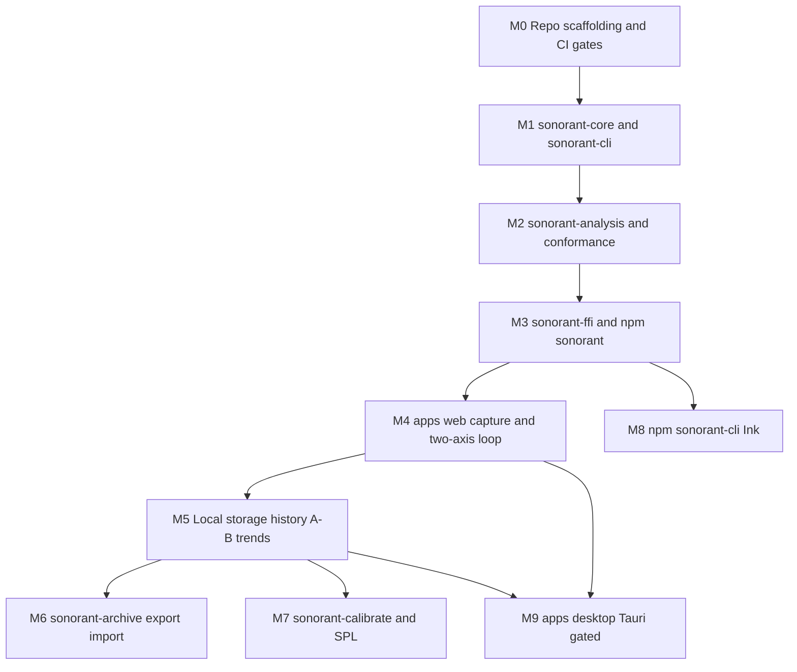

# RRF Phase 7 — Deconstructed Story Breakdown

**Status:** draft
**Tier:** lightweight (from `rrf-00-triage`)
**Owner:** solo builder, with clinical input from a volunteer SLP
**Phase:** 7 of the Risk Reduction Delivery Framework
**Inputs:** phase 3 workflows ([`docs/rrf/03-rough-workflows.md`](03-rough-workflows.md)); phase 5 architecture ([`docs/rrf/05-technical-architecture.md`](05-technical-architecture.md)); phase 6 designs ([`docs/rrf/06-finalize-designs.md`](06-finalize-designs.md)); TDD §1, §3, §4, §5, §7, §8, §9, §14, §15, §16; brief §6, §7
**Output feeds:** phase 8 (test targets), phase 10 (deploy units)

---

## Purpose

This is the phase-7 deliverable at the lightweight tier. It decomposes the initiative into a
milestone roadmap and small, flag-safe stories. Each story carries a cut rationale, Given/When/Then
acceptance criteria with a named owner, a feature flag key, and its dependencies.

**Everything here traces to the brief or the TDD.** Where a story depends on an unresolved open
question, it is marked and the gating item is named in §6. Acceptance criteria are **drafts**;
owners must confirm them before they are treated as build-ready.

**Boundary carried from the brief (§5, §8) and phase 6.** The tool measures and displays; it does
not classify, screen, or diagnose. No screen or story scores femininity, masculinity, or
passability, and none stores such a score. Normative comparison is off by default. Every estimate
carries a confidence indication, and nothing ships without a text summary. The actor is the
**member** (phase 3 lane naming).

**The TDD is authoritative.** Where this document paraphrases the TDD, the TDD wins. Where it
drafts something the TDD leaves open, it is marked as a draft needing confirmation.

---

## How to read this document

- **§1** is the milestone roadmap, ordered to match the TDD's implementation ordering.
- **§2** is the story set, grouped by milestone. Each story has: cut rationale, Given/When/Then
  criteria with owner, flag key, and dependencies.
- **§3** is the dependency map.
- **§4** is the contract coverage check against the phase-5 contracts.
- **§5** is the flag key registry.
- **§6** is the open items carried forward that gate specific stories.

**Owner tags.** UI criteria are owned by **Product/Design**; non-UI criteria are owned by
**Engineering**. The format is Given/When/Then, no exceptions.

**Flag keys.** A flag key is a runtime feature flag where the story has a user-facing surface. Where
a story is a build-time gate or a pure library with no runtime surface, the flag column says so
explicitly rather than inventing a flag. See §5.

---

## 1. Milestone roadmap

The TDD is explicit that the first artifact is the Rust `sonorant-cli` — a fast, debuggable loop on
real recordings with no browser in the way, and the same binary the regression fixtures and the
batch path need (TDD §1, §17). The milestones below follow that ordering.

| Milestone | Name | What it delivers | TDD anchor |
|---|---|---|---|
| **M0** | Repo scaffolding + CI gates | Cargo workspace, npm workspaces + Turborepo, `cargo-deny`/`cargo-audit`, egress bundle scan, CSP | §3, §5, §12, §15 |
| **M1** | `sonorant-core` numerics + `sonorant-cli` (first artifact) | FFT/LPC/YIN/cepstrum/formant numerics; `Analyzer` trait; native batch analyser; fixture generator | §1, §4, §14, §17 |
| **M2** | `sonorant-analysis` frame pipeline + conformance fixtures | Frame pipeline, `AnalysisFrame` assembly, session state machine, Praat-oracle conformance fixtures | §4, §9, §14 |
| **M3** | `sonorant-ffi` + npm `sonorant` WASM wrapper | Thin wasm-bindgen `Engine` surface, `CORE_ABI_VERSION` + wire layout, npm wrapper, wasm hash check | §4.3, §4.4, §9, §12 |
| **M4** | `apps/web` capture shim + live two-axis practice loop | Secure-context check, mandatory mic constraints, AudioWorklet shim + Worker handoff, two-axis pad, confidence + text summary | §6.1, §11; brief §5, §7 |
| **M5** | Local storage + history + A/B + longitudinal trends | Storage schema, opt-in recording to OPFS, history list, A/B comparison, trends with `core_version` boundary marking | §7, §9 |
| **M6** | `sonorant-archive` export/import | ZIP container, `manifest.json`, `payload.enc` AEAD, Argon2id KDF, import merge report, round-trip tests | §8, §14 |
| **M7** | `sonorant-calibrate` + SPL path | Calibration store, dBFS → dB SPL conversion, calibration flow, SPL gating on `calibration_id IS NOT NULL` | §13 |
| **M8** | npm `sonorant-cli` (Ink) user-facing CLI | Ink orchestration CLI, WASM-wrapper route, native shell-out route, CLI errors and exit codes | §3, §4 |
| **M9** | `apps/desktop` (Tauri 2) — **gated** | Tauri shell reusing `apps/web`, native capture (cpal) + device enumeration, capture-shim conformance | §6.2, §16.4 |

**M9 is gated** on the open question of whether the desktop shell ships in v1 (TDD §16.4; brief
§12.2). If it does not ship, M9 is deferred and `sonorant-capture` and the calibration flow stay
off the critical path. See §6.

---

## 2. Stories

### M0 — Repo scaffolding + CI gates

#### S0.1 — Cargo workspace + npm workspaces + Turborepo scaffold

- **Cut:** platform / tooling boundary. Establishes the two tooling layers the TDD names (TDD §3)
  before any code depends on them.
- **Flag:** none — build-time scaffold, no runtime surface.
- **Dependencies:** none.

**Acceptance criteria**

- Given a clean checkout, When a developer runs the workspace build, Then the Cargo workspace and
  the npm workspaces + Turborepo task graph resolve and build with no missing members. — *Owner: Engineering*
- Given the monorepo layout in TDD §3, When the workspace is listed, Then the crates (`sonorant-core`,
  `sonorant-analysis`, `sonorant-calibrate`, `sonorant-archive`, `sonorant-ffi`, `sonorant-capture`,
  `sonorant-cli`) and the apps/packages (`apps/web`, `apps/desktop`, `packages/sonorant`,
  `packages/sonorant-cli`) are present as members. — *Owner: Engineering*

#### S0.2 — `cargo-deny` + `cargo-audit` licence and advisory gate

- **Cut:** contract boundary (supply chain). The gate is mechanical because there is no legal
  department (TDD §5).
- **Flag:** none — CI gate, no runtime surface.
- **Dependencies:** S0.1.

**Acceptance criteria**

- Given a dependency whose licence is outside the allowlist (MIT / Apache-2.0 / BSD-3-Clause / ISC /
  MPL-2.0), When CI runs, Then the build fails rather than the review. — *Owner: Engineering*
- Given an MPL-2.0 dependency used unmodified, When CI runs, Then it passes only with an explicit
  exception comment in `deny.toml`. — *Owner: Engineering*
- Given a known advisory in the dependency graph, When `cargo-audit` runs, Then the build fails. — *Owner: Engineering*

#### S0.3 — Egress bundle origin scan + CSP

- **Cut:** contract boundary (security). Makes the no-network claim verifiable rather than asserted
  (TDD §12).
- **Flag:** none — CI gate plus static headers, no runtime surface.
- **Dependencies:** S0.1.

**Acceptance criteria**

- Given a built bundle containing any external origin, When the egress scan runs, Then the build
  fails on the match. — *Owner: Engineering*
- Given the shipped app, When its CSP is inspected, Then `connect-src 'none'` and
  `frame-ancestors 'none'` are set, and the development-only `cdnjs.cloudflare.com` allowance is not
  inherited. — *Owner: Engineering*

---

### M1 — `sonorant-core` numerics + `sonorant-cli` (first artifact)

#### S1.1 — `sonorant-core` numerics

- **Cut:** contract boundary (the core). The acoustic maths is written once, in-house, with no
  target-specific code and no I/O (TDD §1, §3, §5).
- **Flag:** none — pure library, no runtime surface.
- **Dependencies:** S0.1, S0.2.

**Acceptance criteria**

- Given synthetic signals with known formants (a cascade of known resonators) and known F0, When the
  numerics run, Then the measured values fall within the documented per-measure tolerance bands. — *Owner: Engineering*
- Given `sonorant-core`, When it is compiled, Then it carries `#![forbid(unsafe_code)]` and has no
  target-specific code and no I/O. — *Owner: Engineering*
- Given arbitrary frame sizes, silence, clipping, and NaN input, When the numerics run, Then the core
  never panics and never emits a non-finite value outside the documented `NaN` cases. — *Owner: Engineering*

#### S1.2 — `AnalysisParams` + `Analyzer` trait

- **Cut:** contract boundary. Implements the `Analyzer` contract and `AnalysisParams` from TDD §4.1
  so every surface drives the same shape.
- **Flag:** none — pure library, no runtime surface.
- **Dependencies:** S1.1.

**Acceptance criteria**

- Given `AnalysisParams` with defaults (`frame_len` 2048, `hop` 512, `pre_emphasis` 0.97,
  `lpc_order` = clamp(2 + sample_rate/1000, 18, 24), `max_formant_hz` 5500), When `configure` is
  called, Then the analyzer adopts them. — *Owner: Engineering*
- Given PCM pushed via `push`, When `drain` is called, Then zero or more `AnalysisFrame`s are written
  and the count returned matches the frames written. — *Owner: Engineering*
- Given `reset`, When the next `push`/`drain` cycle runs, Then internal state is cleared. — *Owner: Engineering*

#### S1.3 — Native `sonorant-cli` batch analyser

- **Cut:** platform (native CLI). The first artifact, giving a fast debuggable loop on real
  recordings with no browser (TDD §1, §17).
- **Flag:** none — developer/batch tool, no runtime surface.
- **Dependencies:** S1.2.

**Acceptance criteria**

- Given a WAV file, When the batch analyser runs, Then it emits `AnalysisFrame` output for the file
  through the same `Analyzer` contract. — *Owner: Engineering*
- Given a missing or unsupported input file, When the analyser runs, Then it exits non-zero with a
  plain-text message stating cause and next step. — *Owner: Engineering*

#### S1.4 — Fixture generator

- **Cut:** contract boundary (test fixtures). The same binary the regression fixtures need (TDD §1,
  §14).
- **Flag:** none — developer tool, no runtime surface.
- **Dependencies:** S1.3.

**Acceptance criteria**

- Given a reference recording, When the fixture generator runs, Then it produces a fixture with
  expected values and the documented per-measure tolerance bands. — *Owner: Engineering*
- Given the generated fixtures, When they are published with the project, Then a fork cannot be the
  only authority on how the numbers are produced. — *Owner: Engineering*

---

### M2 — `sonorant-analysis` frame pipeline + conformance fixtures

#### S2.1 — Frame pipeline + `AnalysisFrame` assembly

- **Cut:** contract boundary. Assembles the `AnalysisFrame` from the core numerics (TDD §4.1).
- **Flag:** none — pure library, no runtime surface.
- **Dependencies:** S1.2.

**Acceptance criteria**

- Given PCM, When the frame pipeline runs, Then it emits `AnalysisFrame`s with the field set in TDD
  §4.1, including `scale_semitones` computed in the core against the session baseline. — *Owner: Engineering*
- Given an uncalibrated session, When a frame is assembled, Then `spl_db` is `NaN` and the
  `UNCALIBRATED` flag is set. — *Owner: Engineering*
- Given a frame with a measured quantity, When it is emitted, Then it carries a confidence value. — *Owner: Engineering*

#### S2.2 — Session state machine

- **Cut:** workflow step. Owns session start/stop and the baseline `scale_semitones` is relative to
  (TDD §4.1, §4.2).
- **Flag:** none — pure library, no runtime surface.
- **Dependencies:** S2.1.

**Acceptance criteria**

- Given a session start, When frames are produced, Then `t_ms` is measured since session start. — *Owner: Engineering*
- Given a session baseline, When `scale_semitones` is computed, Then it is a log-ratio against that
  session's own baseline, identical everywhere it is read. — *Owner: Engineering*

#### S2.3 — Conformance fixture set (Praat oracle)

- **Cut:** contract boundary (accuracy). Praat is an offline validation oracle that ships nothing
  (TDD §5, §14).
- **Flag:** none — test asset, no runtime surface.
- **Dependencies:** S1.4, S2.1.

**Acceptance criteria**

- Given the reference recordings, When conformance runs, Then assertions use documented per-measure
  tolerance bands, not equality. — *Owner: Engineering*
- Given a measure that has moved beyond its documented tolerance, When conformance runs, Then it is
  treated as a MAJOR `CORE_VERSION` bump, mechanically rather than by judgement. — *Owner: Engineering*

#### S2.4 — Property tests

- **Cut:** contract boundary (robustness). The core must never panic and never emit a non-finite
  value outside the documented `NaN` cases (TDD §14).
- **Flag:** none — test asset, no runtime surface.
- **Dependencies:** S2.1.

**Acceptance criteria**

- Given frame boundaries, arbitrary frame sizes, silence, clipping, and NaN input, When property
  tests run, Then the core never panics. — *Owner: Engineering*
- Given silence, When frames are produced, Then `f0_hz <= 0.0` marks the frame unvoiced. — *Owner: Engineering*

---

### M3 — `sonorant-ffi` + npm `sonorant` WASM wrapper

#### S3.1 — `sonorant-ffi` `Engine` surface

- **Cut:** contract boundary (FFI). Thin wasm-bindgen surface, no logic (TDD §4.3).
- **Flag:** none — library surface, no runtime surface.
- **Dependencies:** S2.1.

**Acceptance criteria**

- Given the `Engine` constructor with a sample rate, When `configure`, `push`, `frames_ptr`,
  `frames_len`, `reset`, `core_version`, and `abi_version` are called, Then they behave as specified
  in TDD §4.3. — *Owner: Engineering*
- Given `sonorant-ffi`, When it is inspected, Then it contains no acoustic logic. — *Owner: Engineering*

#### S3.2 — `CORE_ABI_VERSION` + wire layout + ABI test

- **Cut:** contract boundary (ABI). The wire layout is a one-way contract (TDD §4.4, §9.5).
- **Flag:** none — build/test gate, no runtime surface.
- **Dependencies:** S3.1.
- **Gated by:** the `AnalysisFrame` wire-layout arithmetic discrepancy (phase 5 §3.7, §6.2). The
  exact stride must be confirmed before the ABI test is written. See §6.

**Acceptance criteria**

- Given a `CORE_ABI_VERSION`, When the JS reader reads the core's layout, Then the ABI test passes;
  a mismatch fails CI. — *Owner: Engineering*
- Given a mismatch between the JS reader and the core at startup, When the app starts, Then it is a
  hard startup failure, not a silent misread. — *Owner: Engineering*

#### S3.3 — npm `sonorant` WASM wrapper

- **Cut:** platform (npm library). The package a web or TypeScript consumer imports (TDD §3).
- **Flag:** none — library package, no runtime surface.
- **Dependencies:** S3.1, S3.2.

**Acceptance criteria**

- Given the npm `sonorant` package, When it is installed, Then it ships the `sonorant_core_bg.wasm`
  artifact plus the typed loader. — *Owner: Engineering*
- Given the shipped `.wasm`, When its hash is compared at startup, Then a mismatch is a hard failure. — *Owner: Engineering*

---

### M4 — `apps/web` capture shim + live two-axis practice loop

#### S4.1 — Secure-context check + microphone permission with mandatory constraints

- **Cut:** workflow step (first-run). Phase 3 flow 1; phase 6 S1.1, S1.2.
- **Flag:** `enable-web-capture`.
- **Dependencies:** S3.3.

**Acceptance criteria**

- Given an insecure context, When the app starts, Then a blocking error panel states the microphone
  needs HTTPS and nothing is recorded until it is fixed. — *Owner: Product/Design*
- Given a secure context, When the member grants permission, Then the app requests the microphone
  with `echoCancellation: false`, `noiseSuppression: false`, `autoGainControl: false`, and
  `channelCount: 1`, applied by the app and not surfaced as a member choice. — *Owner: Engineering*
- Given permission denied, When the member sees the error, Then it is guidance with a `Try again`
  action, not a dead end. — *Owner: Product/Design*

#### S4.2 — AudioWorklet shim + Worker handoff

- **Cut:** platform (browser capture). Capture in the callback, analyse on a worker (TDD §6.1).
- **Flag:** `enable-web-capture`.
- **Dependencies:** S4.1.

**Acceptance criteria**

- Given the AudioWorklet, When it loads the WASM core, Then it uses the `--target no-modules`
  approach or a JS `AudioWorkletProcessor` calling into WASM, because an ES module does not resolve
  in the worklet scope. — *Owner: Engineering*
- Given the audio callback, When frames are captured, Then they are copied into a transferable
  `Float32Array` and posted to a worker; LPC root-finding and cepstral analysis do not run in the
  callback. — *Owner: Engineering*
- Given `SharedArrayBuffer` availability, When the shim runs, Then SAB is feature-detected and used
  only as an optimisation, with `postMessage` transferables as the default. — *Owner: Engineering*

#### S4.3 — Live two-axis pitch × resonance pad

- **Cut:** workflow step (core practice loop). Phase 3 flow 2; phase 6 S2.2; brief §5 principle 1.
- **Flag:** `enable-live-two-axis-pad`.
- **Dependencies:** S4.2.

**Acceptance criteria**

- Given a live session, When frames arrive, Then pitch and resonance are plotted as two axes that are
  always visually separable, each labelled in text and each series carrying a distinct shape or
  pattern as well as a colour. — *Owner: Product/Design*
- Given low confidence, When the pad renders, Then it is visibly marked not trustworthy with a text
  banner, and the confidence overlay uses a pattern or hatch plus a text label, not colour alone. — *Owner: Product/Design*
- Given `prefers-reduced-motion: reduce`, When values update, Then they update without animation. — *Owner: Product/Design*

#### S4.4 — Confidence indication + text summary

- **Cut:** workflow step. Phase 3 flow 2; phase 6 S2.3, S2.4; brief §7.
- **Flag:** `enable-live-two-axis-pad`.
- **Dependencies:** S4.3.

**Acceptance criteria**

- Given any displayed estimate, When it is shown, Then it carries a confidence indication, and a
  value without a confidence is not displayable. — *Owner: Product/Design*
- Given mean formant confidence below 0.6 or voicing confidence p05 below 0.4, When the summary
  renders, Then it says the numbers are not reliable yet rather than presenting them as fact. — *Owner: Product/Design*
- Given a screen reader user, When they read the summary, Then it is complete enough to stand alone
  as the accessible equivalent of the pad. — *Owner: Product/Design*

---

### M5 — Local storage + history + A/B + longitudinal trends

#### S5.1 — Local storage schema

- **Cut:** contract boundary (storage). The `session`, `utterance`, `metric_series`, `calibration`,
  and `measure_version` tables (TDD §7.1).
- **Flag:** `enable-local-history`.
- **Dependencies:** S4.2.
- **Gated by:** the `AnalysisSummary` structure, which is a proposed draft needing confirmation
  (phase 5 §3.4, §6.1). See §6.

**Acceptance criteria**

- Given a completed session, When it is stored, Then a `session` row carries `app_version`,
  `core_version`, `abi_version`, and `schema_version`. — *Owner: Engineering*
- Given an utterance, When it is stored, Then an `utterance` row carries `kind`, `duration_ms`, and
  `metrics_json`, and `metric_series` rows are written per channel with `value` and `confidence`. — *Owner: Engineering*
- Given a stored record, When it is read, Then it carries the `core_version` that produced it, and a
  `measure_version` row exists for that version. — *Owner: Engineering*
- Given a session with no calibration, When it is stored, Then `calibration_id` is `NULL` and SPL
  values are `NULL`, not zero. — *Owner: Engineering*

#### S5.2 — Opt-in recording to OPFS

- **Cut:** workflow step. Phase 3 flow 2; phase 6 S2.5; TDD §7.
- **Flag:** `enable-recording`.
- **Dependencies:** S5.1.

**Acceptance criteria**

- Given recording off, When a session runs, Then frames are analysed and discarded in memory and no
  audio is written. — *Owner: Engineering*
- Given recording on, When a session runs, Then audio is written to OPFS and the member sees a clear
  indicator and a stop control. — *Owner: Product/Design*
- Given an OPFS write failure, When it occurs, Then the session continues, the audio is not kept, and
  the member is told. — *Owner: Product/Design*

#### S5.3 — History list + A/B comparison

- **Cut:** workflow step (history). Phase 3 flow 3; phase 6 S3.1, S3.2; brief §5 principle 4.
- **Flag:** `enable-history-ab`.
- **Dependencies:** S5.1.

**Acceptance criteria**

- Given stored sessions, When the member opens history, Then rows load from IndexedDB newest first
  with date, exercise kind, and a short summary that includes confidence. — *Owner: Product/Design*
- Given two utterances, When the member compares them, Then the comparison is self-referential by
  default, labelled `Earlier` and `Now` in text, and normative comparison is off. — *Owner: Product/Design*
- Given one side has no audio or confidence too low to compare, When the comparison renders, Then it
  states that plainly rather than showing a misleading comparison. — *Owner: Product/Design*

#### S5.4 — Longitudinal trends + `core_version` boundary marking

- **Cut:** workflow step (trends). Phase 3 flow 3; phase 6 S3.3; TDD §9.
- **Flag:** `enable-longitudinal-trends`.
- **Dependencies:** S5.1.

**Acceptance criteria**

- Given stored `metric_series`, When a trend renders, Then it shows distribution shift and sparklines
  with a text alternative stating direction and range with confidence. — *Owner: Product/Design*
- Given a `core_version` boundary, When the chart crosses it, Then it marks a visible discontinuity
  with a line, a label, and a text note, or stops at the boundary if continuing would mislead. — *Owner: Product/Design*
- Given a boundary, When the chart renders, Then it does not re-analyse historical audio to make old
  points comparable. — *Owner: Engineering*

---

### M6 — `sonorant-archive` export/import

#### S6.1 — ZIP container + `manifest.json`

- **Cut:** contract boundary (archive). The plaintext manifest is deliberately readable without a
  passphrase (TDD §8).
- **Flag:** `enable-archive-export`.
- **Dependencies:** S5.1.

**Acceptance criteria**

- Given an export, When the container is written, Then `manifest.json` carries `format`,
  `format_version`, `schema_version`, `core_version`, `abi_version`, `created_at`, `encrypted`,
  `kdf`, and `counts`. — *Owner: Engineering*
- Given a manifest, When it is read without a passphrase, Then a user can tell what the file is. — *Owner: Engineering*

#### S6.2 — `payload.enc` AEAD + Argon2id KDF

- **Cut:** contract boundary (archive encryption). XChaCha20-Poly1305 under an Argon2id-derived key
  (TDD §8).
- **Flag:** `enable-archive-export`.
- **Dependencies:** S6.1.
- **Gated by:** the Argon2id parameters (`m`, `t`, `p`), which need a decision against a device-class
  time budget (TDD §16.5; phase 5 §6.4). See §6.

**Acceptance criteria**

- Given a passphrase, When the payload is encrypted, Then it uses XChaCha20-Poly1305 under a key
  derived with Argon2id, and the parameters are recorded in `manifest.json`. — *Owner: Engineering*
- Given a wrong passphrase, When import runs, Then it fails cleanly and nothing is changed. — *Owner: Engineering*
- Given a plaintext export, When it is chosen, Then it is an explicit, warned choice, not the
  default. — *Owner: Product/Design*

#### S6.3 — Import merge report + version skew

- **Cut:** workflow step (import). Phase 3 flow 4; phase 6 S4.3; TDD §8.
- **Flag:** `enable-archive-import`.
- **Dependencies:** S6.2.

**Acceptance criteria**

- Given a supported archive, When import runs, Then it merges by id and reports what it added,
  skipped, or conflicted on, and never silently overwrites. — *Owner: Product/Design*
- Given an archive from a newer format version, When import runs, Then it is refused with a clear
  message rather than partially parsed. — *Owner: Product/Design*
- Given a truncated archive, When import runs, Then it fails cleanly and nothing is imported. — *Owner: Product/Design*

#### S6.4 — Archive round-trip tests

- **Cut:** contract boundary (test). Export → import with version skew in both directions (TDD §14).
- **Flag:** none — test asset, no runtime surface.
- **Dependencies:** S6.3.

**Acceptance criteria**

- Given an export, When it is imported, Then the round trip preserves the records. — *Owner: Engineering*
- Given version skew in either direction, a truncated file, a wrong passphrase, and a newer format
  version, When the tests run, Then all fail cleanly. — *Owner: Engineering*

---

### M7 — `sonorant-calibrate` + SPL path

#### S7.1 — Calibration store + dBFS → dB SPL conversion

- **Cut:** contract boundary (calibration). Per-device and per-mic sensitivity (TDD §13).
- **Flag:** `enable-calibration`.
- **Dependencies:** S5.1.

**Acceptance criteria**

- Given a calibration, When it is stored, Then a `calibration` row carries `device_class`,
  `mic_model`, `sensitivity_dbfs_at_94db`, `method`, and `measured_at`. — *Owner: Engineering*
- Given an active calibration, When SPL is computed, Then dBFS is converted to dB SPL; without one,
  `spl_db` stays `NaN`. — *Owner: Engineering*
- Given a shipped default sensitivity, When it is used, Then it is labelled an estimate rather than a
  calibration. — *Owner: Product/Design*

#### S7.2 — Calibration flow + SPL gating

- **Cut:** workflow step (first-run calibration). Phase 3 flow 1; phase 6 S1.4.
- **Flag:** `enable-spl-display`.
- **Dependencies:** S7.1.

**Acceptance criteria**

- Given the calibration step, When the member skips it, Then skipping is a first-class choice and SPL
  stays blank, shown as `Not calibrated`, never a zero or a fake axis. — *Owner: Product/Design*
- Given no calibration, When SPL-dependent features are reached, Then they are gated on
  `calibration_id IS NOT NULL` and unreachable on the web target by design. — *Owner: Engineering*
- Given a calibration failure (no reference tone), When it occurs, Then nothing is changed and the
  member can try again or skip. — *Owner: Product/Design*

---

### M8 — npm `sonorant-cli` (Ink) user-facing CLI

#### S8.1 — Ink CLI command parsing + core drive

- **Cut:** platform (npm CLI). Orchestration and presentation only, no acoustic maths (TDD §3).
- **Flag:** `enable-cli-ink`.
- **Dependencies:** S3.3.

**Acceptance criteria**

- Given a command, When the Ink CLI runs, Then it drives the Rust core through the `Analyzer` /
  `Engine` contract via the `sonorant` WASM wrapper. — *Owner: Engineering*
- Given the CLI, When it is inspected, Then it contains no acoustic maths. — *Owner: Engineering*
- Given results, When they are printed, Then status is also a word (`ok`, `warning`, `error`), not
  colour alone. — *Owner: Product/Design*

#### S8.2 — Native shell-out path

- **Cut:** contract boundary (batch/conformance). Shells out to the native `sonorant-cli` binary
  where the native path is faster (TDD §3).
- **Flag:** `enable-cli-ink`.
- **Dependencies:** S8.1, S1.3.

**Acceptance criteria**

- Given batch or conformance work, When the CLI runs, Then it shells out to the native `sonorant-cli`
  binary and both routes go through the same contract. — *Owner: Engineering*
- Given a long-running batch, When it runs, Then progress is text, not a spinner alone, and a
  non-interactive mode is available. — *Owner: Product/Design*

#### S8.3 — CLI errors + exit codes

- **Cut:** workflow step (CLI errors). Phase 6 S5.3; TDD §4.4, §9.5, §12.
- **Flag:** `enable-cli-ink`.
- **Dependencies:** S8.1.

**Acceptance criteria**

- Given a `CORE_ABI_VERSION` mismatch, When the CLI runs, Then it prints a plain-text message
  stating cause and next step and exits non-zero. — *Owner: Engineering*
- Given a wasm hash mismatch, When the CLI runs, Then it prints a plain-text message and exits
  non-zero. — *Owner: Engineering*
- Given a missing or unsupported input file, When the CLI runs, Then it prints a plain-text message
  and exits non-zero. — *Owner: Engineering*

---

### M9 — `apps/desktop` (Tauri 2) — gated

> **Gated.** M9 is gated on the open question of whether the desktop shell ships in v1 (TDD §16.4;
> brief §12.2). If it does not ship, these stories are deferred and `sonorant-capture` and the
> calibration flow stay off the critical path. See §6.

#### S9.1 — Tauri 2 shell reusing `apps/web`

- **Cut:** platform (desktop). The shell is an addition, not a fork (TDD §1, §3).
- **Flag:** `enable-desktop-shell`.
- **Dependencies:** S4.3, S5.1.

**Acceptance criteria**

- Given the Tauri 2 shell, When it runs, Then it reuses the entire web UI rather than forking it. — *Owner: Engineering*
- Given the shell, When it is built, Then it is built from the same commit and the same
  `CORE_VERSION` as the web artifact and the CLI. — *Owner: Engineering*

#### S9.2 — Native capture (cpal) + device enumeration

- **Cut:** platform (native capture). Unlocks calibrated SPL and all-day capture (TDD §6.2).
- **Flag:** `enable-native-capture`.
- **Dependencies:** S9.1.

**Acceptance criteria**

- Given the native capture contract, When `devices`, `start`, and `stop` are called, Then they behave
  as specified in TDD §6.3. — *Owner: Engineering*
- Given the audio callback, When frames are captured, Then they are copied to a ring buffer and
  handed off, and the callback returns under the real-time budget. — *Owner: Engineering*

#### S9.3 — Capture-shim conformance fixtures

- **Cut:** contract boundary (capture conformance). The browser shim and native capture are kept
  honest by a shared fixture set, not a shared trait (TDD §6, §14).
- **Flag:** none — test asset, no runtime surface.
- **Dependencies:** S9.2, S4.2.

**Acceptance criteria**

- Given the same PCM fixture, When the browser shim and native capture are driven, Then they produce
  identical `AnalysisFrame` sequences. — *Owner: Engineering*

---

## 3. Dependency map

### 3.1 Milestone dependency graph

### 3.2 Story dependency table

| Story | Depends on | Milestone |
|---|---|---|
| S0.1 | — | M0 |
| S0.2 | S0.1 | M0 |
| S0.3 | S0.1 | M0 |
| S1.1 | S0.1, S0.2 | M1 |
| S1.2 | S1.1 | M1 |
| S1.3 | S1.2 | M1 |
| S1.4 | S1.3 | M1 |
| S2.1 | S1.2 | M2 |
| S2.2 | S2.1 | M2 |
| S2.3 | S1.4, S2.1 | M2 |
| S2.4 | S2.1 | M2 |
| S3.1 | S2.1 | M3 |
| S3.2 | S3.1 | M3 |
| S3.3 | S3.1, S3.2 | M3 |
| S4.1 | S3.3 | M4 |
| S4.2 | S4.1 | M4 |
| S4.3 | S4.2 | M4 |
| S4.4 | S4.3 | M4 |
| S5.1 | S4.2 | M5 |
| S5.2 | S5.1 | M5 |
| S5.3 | S5.1 | M5 |
| S5.4 | S5.1 | M5 |
| S6.1 | S5.1 | M6 |
| S6.2 | S6.1 | M6 |
| S6.3 | S6.2 | M6 |
| S6.4 | S6.3 | M6 |
| S7.1 | S5.1 | M7 |
| S7.2 | S7.1 | M7 |
| S8.1 | S3.3 | M8 |
| S8.2 | S8.1, S1.3 | M8 |
| S8.3 | S8.1 | M8 |
| S9.1 | S4.3, S5.1 | M9 |
| S9.2 | S9.1 | M9 |
| S9.3 | S9.2, S4.2 | M9 |

---

## 4. Contract coverage check

Every phase-5 contract must have at least one consuming story. The phase-5 contracts are the
`Analyzer` / `Engine` contract, the `AnalysisFrame` wire layout, `AnalysisParams`, the archive
`manifest.json`, and the storage schema (`session`, `utterance`, `metric_series`, `calibration`,
`measure_version`).

| Phase-5 contract | Consuming story/stories | Status |
|---|---|---|
| `Analyzer` / `Engine` contract (TDD §4.1, §4.3) | S1.2 (`Analyzer` trait), S3.1 (`Engine` FFI), S8.1 (CLI drives it) | Covered |
| `AnalysisFrame` wire layout (TDD §4.4) | S3.2 (ABI test), S4.2 (worker reads frames) | Covered |
| `AnalysisParams` (TDD §4.1) | S1.2 | Covered |
| Archive `manifest.json` (TDD §8) | S6.1 | Covered |
| Storage schema — `session` (TDD §7.1) | S5.1 | Covered |
| Storage schema — `utterance` (TDD §7.1) | S5.1 | Covered |
| Storage schema — `metric_series` (TDD §7.1) | S5.1, S5.4 | Covered |
| Storage schema — `calibration` (TDD §7.1) | S7.1 | Covered |
| Storage schema — `measure_version` (TDD §7.1) | S5.1, S5.4 | Covered |

**No confirmed phase-5 contract lacks a consuming story.**

**Two caveats, both carried from phase 5:**

1. **`AnalysisSummary` is a proposed draft, not a confirmed contract** (phase 5 §3.4, §6.1). It is
   the content of `utterance.metrics_json` and is consumed by S5.1 and S5.3, but it must be
   confirmed before it is treated as a contract. It is not counted as a confirmed contract above.
2. **The `AnalysisFrame` wire-layout arithmetic discrepancy is unresolved** (phase 5 §3.7, §6.2).
   S3.2 consumes the wire layout but is gated on confirming the exact stride before the ABI test is
   written. See §6.

---

## 5. Flag key registry

Every flag key referenced by a story, listed once. Flags marked **build-time gate** have no runtime
surface and are listed for completeness.

| Flag key | Stories | Kind |
|---|---|---|
| `enable-web-capture` | S4.1, S4.2 | Runtime |
| `enable-live-two-axis-pad` | S4.3, S4.4 | Runtime |
| `enable-local-history` | S5.1 | Runtime |
| `enable-recording` | S5.2 | Runtime |
| `enable-history-ab` | S5.3 | Runtime |
| `enable-longitudinal-trends` | S5.4 | Runtime |
| `enable-archive-export` | S6.1, S6.2 | Runtime |
| `enable-archive-import` | S6.3 | Runtime |
| `enable-calibration` | S7.1 | Runtime |
| `enable-spl-display` | S7.2 | Runtime |
| `enable-cli-ink` | S8.1, S8.2, S8.3 | Runtime |
| `enable-desktop-shell` | S9.1 | Runtime |
| `enable-native-capture` | S9.2 | Runtime |

**Build-time gates (no runtime flag):** S0.1, S0.2, S0.3, S1.1, S1.2, S1.3, S1.4, S2.1, S2.2, S2.3,
S2.4, S3.1, S3.2, S3.3, S6.4, S9.3.

**Not yet assigned (gaps, not stories):** the phase-6 gaps for MPT and the practice calendar
(phase 6 §3, §4.1) have no story and therefore no flag key. If they are added, candidate keys are
`enable-mpt-exercise` and `enable-practice-calendar`. They are recorded here as gaps, not invented
as stories.

---

## 6. Open items carried forward

These are the TDD §16 open questions and the phase-5 discrepancies that gate specific stories. Each
names the story it gates.

| Open item | Source | Gates |
|---|---|---|
| **`AnalysisFrame` wire-layout arithmetic discrepancy.** TDD §4.4 states 25 `f32` + 1 `u32` = 26 words; the field list in TDD §4.1 sums to 28 `f32` plus `u32` and `u16`. The exact stride must be confirmed before the ABI test is written, because the wire layout is a one-way contract. | TDD §4.1, §4.4; phase 5 §3.7, §6.2 | **S3.2** (ABI test) |
| **`AnalysisSummary` structure — proposed, needs confirmation.** The TDD references it as the content of `utterance.metrics_json` but does not define it. | TDD §7.1; phase 5 §3.4, §6.1 | **S5.1**, **S5.3** |
| **Argon2id parameters for the archive KDF.** `m`, `t`, `p` need a decision against an explicit device-class time budget, since a phone must open its own archive in reasonable time. | TDD §8, §16.5; phase 5 §6.4 | **S6.2** |
| **Whether the desktop shell ships in v1.** If yes, `sonorant-capture` and the calibration flow move into the critical path rather than staying deferred. | TDD §16.4; brief §12.2; phase 5 §6.8 | **M9** (S9.1, S9.2, S9.3) |
| **JSON representation of `spl_db` `NaN`.** JSON has no `NaN` literal; the phase-5 schema uses `null`, and the convention must be consistent between the archive and the local rows. | TDD §4.2, §7.1, §8; phase 5 §6.3 | **S5.1**, **S6.1** |
| **Unverified dependency licences.** `pitch-detection`, `pyin-rs`, `hound`, `symphonia`, `zip`, and both prior-art voice crates must be verified before any becomes a dependency. `symphonia` is MPL-2.0 and needs an explicit exception comment if used unmodified. | TDD §5, §16.1; phase 5 §6.6 | **S0.2**, **S1.1**, **S6.1** |
| **SQLite versus IndexedDB for the local store.** Deferred; the schema is the contract, not the engine, so it can be adopted behind the storage layer without changing the archive format. | TDD §7, §16.6; phase 5 §6.5 | **S5.1** |
| **Phoneme classifier for per-vowel analysis.** Build in Rust, vendor, or defer past v1. | TDD §16.3; brief §12.3; phase 5 §6.9 | No story yet — deferred past v1 |
| **Specific microphone and calibrator pairing.** A separate equipment research pass with cited sources. The category is verified; a specific pairing is not. | TDD §13, §16.2; brief §12.1; phase 5 §6.10 | **S7.1**, **S7.2** |
| **Build-toolchain / registry offline strategy.** No vendoring or offline-build approach is specified; confirmed in phase 5 as a mitigation with no architectural home. | Phase 4 §3.3, §7.7; phase 5 §5.1, §6.7 | **S0.1**, **S0.2** |
| **MPT exercise and practice calendar.** Brief §7 lists both in the fixed Phase 1 set; no phase-3 flow and no phase-6 screen specs them. | Brief §7; phase 6 §3, §4.1 | No story yet — needs a decision: add a screen, or amend the brief's Phase 1 list |

---

## Source

- [`docs/TDD — Rust analysis core & local-first deployment.md`](../TDD%20%E2%80%94%20Rust%20analysis%20core%20%26%20local-first%20deployment.md) — decision and first-artifact ordering (§1), architecture and monorepo layout (§3), core contract and wire layout (§4), dependency register (§5), capture constraints (§6), local storage and migrations (§7), export/import (§8), measure versioning and ABI stability (§9), deployment and rollback (§10), diagnostics thresholds (§11), security review (§12), calibration (§13), testing (§14), build and release (§15), open questions (§16), what this document does not contain (§17).
- [`docs/Project brief — voice analysis & training tool.md`](../Project%20brief%20%E2%80%94%20voice%20analysis%20%26%20training%20tool.md) — principles (§5), scope (§6), visualisation inventory and Phase 1 fixed list (§7), claims/ethics (§8), SLP boundary (§9), operator story (§10), open questions (§12), non-goals (§13).
- [`docs/rrf/03-rough-workflows.md`](03-rough-workflows.md) — flows and edge-case dispositions.
- [`docs/rrf/05-technical-architecture.md`](05-technical-architecture.md) — contract drafts, storage schema, and open items.
- [`docs/rrf/06-finalize-designs.md`](06-finalize-designs.md) — screen specs, gaps, and feasibility loop.
- [`docs/rrf/04-risk-constraints.md`](04-risk-constraints.md) — risk register.
- [`docs/rrf/01-ideation-intake.md`](01-ideation-intake.md) — phase 1 problem statement.
- [`docs/rrf/02-five-whys-context.md`](02-five-whys-context.md) — phase 2 context.
